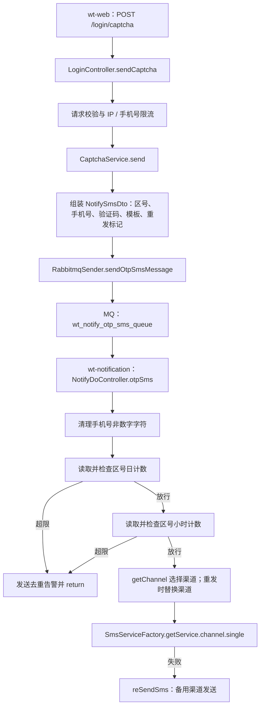
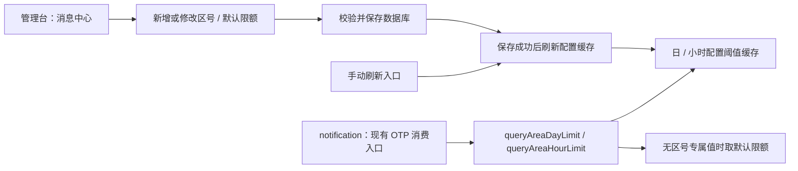

# 短信限额迁移：代码位置与执行流程

梳理日期：2026-10-15。需求来源：[tem.md](C:/Users/erzhuochen/Desktop/笔记/tem.md)。代码范围：`D:/workspace/wh/wt` 下当前检出的服务。本次只整理代码与需求，不修改业务代码。

## 1. 结论与已确认范围

需求直接对应 `wt-notification` 的 `NotifyDoController.otpSms()`、`queryAreaDayLimit()`、`queryAreaHourLimit()` 和 `SmsConfig`。现状是：**发送计数已经存 Redis，但允许发送的配置阈值仍从 Nacos 绑定的配置对象读取。** 需要迁移的是配置阈值的数据来源。

已确认的需求边界：

- 保持当前 OTP 限额覆盖范围；普通通知短信、华为 OTP 等入口本次不扩大覆盖。
- 保留“区号专属值 → 全局默认值”的回退规则，并将全局默认日／小时限额一起迁移到数据库和管理台。
- 管理台保存成功后自动刷新配置缓存，同时提供手动刷新入口。

当前工作区未定位到管理台的消息中心菜单、页面及限额管理接口。`wt-web` 是 APP 接口服务；[ManagerDataClient.java:22](D:/workspace/wh/wt/wt-web/src/main/java/com/wotransfer/web/client/ManagerDataClient.java:22) 声明了对 `service-manager-data` 的调用，只能据此确认存在外部管理服务，不能据此确定管理台仓库与菜单位置。

## 2. 最先阅读的代码

| 优先级 | 位置 | 阅读重点 |
| --- | --- | --- |
| 1 | [NotifyDoController.java:143](D:/workspace/wh/wt/wt-notification/src/main/java/com/wotransfer/notification/controller/NotifyDoController.java:143) | OTP 消费入口：解析参数 → 日限额 → 小时限额 → 选择渠道 → 发送／备用发送 |
| 2 | [NotifyDoController.java:374](D:/workspace/wh/wt/wt-notification/src/main/java/com/wotransfer/notification/controller/NotifyDoController.java:374) | `queryAreaDayLimit(areaCode)`：按区号查 JSON，未命中取默认日限额 |
| 3 | [NotifyDoController.java:383](D:/workspace/wh/wt/wt-notification/src/main/java/com/wotransfer/notification/controller/NotifyDoController.java:383) | `queryAreaHourLimit(areaCode)`：按区号查 JSON，未命中取默认小时限额 |
| 4 | [SmsConfig.java:15](D:/workspace/wh/wt/wt-notification/src/main/java/com/wotransfer/notification/configuration/SmsConfig.java:15) | 配置绑定与 Java 初始值；保留属性名中的 `opt` 拼写，避免查错配置 |
| 5 | [LoginController.java:228](D:/workspace/wh/wt/wt-web/src/main/java/com/wotransfer/web/login/LoginController.java:228) | 上游 `POST /login/captcha`，已有 IP／手机号层面的独立拦截 |
| 6 | [CaptchaService.java:96](D:/workspace/wh/wt/wt-web/src/main/java/com/wotransfer/web/common/service/CaptchaService.java:96) | 组装 `NotifySmsDto` 并发送 OTP 队列消息 |
| 7 | [RabbitmqSender.java:101](D:/workspace/wh/wt/wt-web/src/main/java/com/wotransfer/web/common/rabbitmq/RabbitmqSender.java:101) | 通过 `RabbitTemplate.convertAndSend()` 写入 OTP 队列 |

## 3. 当前实际执行流程

### 3.1 从登录验证码请求到短信供应商

以下是已核实的登录验证码主链路，不代表所有业务生产者的穷举。



分步对应位置：

1. [LoginController.java:367](D:/workspace/wh/wt/wt-web/src/main/java/com/wotransfer/web/login/LoginController.java:367) 调用 `checkIpAndSendLimits()`；其实现从 [454 行](D:/workspace/wh/wt/wt-web/src/main/java/com/wotransfer/web/login/LoginController.java:454) 开始。它检查 IP、手机号的计数，使用 `maxIPCaptchaCount`、`maxPhoneCaptchaCount`，与本需求的区号汇总限额是两套规则。
2. [LoginController.java:405](D:/workspace/wh/wt/wt-web/src/main/java/com/wotransfer/web/login/LoginController.java:405) 调用 `captchaService.send()`；随后在 407—409 行更新上游 IP／手机号计数。
3. [CaptchaService.java:112](D:/workspace/wh/wt/wt-web/src/main/java/com/wotransfer/web/common/service/CaptchaService.java:112) 组装 `NotifySmsDto`：`areaCode`、`phoneNumbers`、`reTry`、`source=OTP`、验证码和模板；[173 行](D:/workspace/wh/wt/wt-web/src/main/java/com/wotransfer/web/common/service/CaptchaService.java:173) 发 MQ，175—176 行缓存验证码，失效时间为 600 秒。
4. [RabbitmqSender.java:101](D:/workspace/wh/wt/wt-web/src/main/java/com/wotransfer/web/common/rabbitmq/RabbitmqSender.java:101) 将消息发到 `RabbitConst.WT_NOTIFY_OTP_SMS_QUEUE`。常量的实际值是 `wt_notify_otp_sms_queue`，见 [RabbitConst.java:18](D:/workspace/wh/wt/wt-core/src/main/java/com/wotransfer/core/constants/RabbitConst.java:18)。通知服务的队列声明和绑定见 [RabbitMqConfig.java:185](D:/workspace/wh/wt/wt-notification/src/main/java/com/wotransfer/notification/configuration/RabbitMqConfig.java:185)。
5. [NotifyDoController.java:145](D:/workspace/wh/wt/wt-notification/src/main/java/com/wotransfer/notification/controller/NotifyDoController.java:145) 消费消息；152 行只清理手机号，**没有规范化区号**。
6. [159 行](D:/workspace/wh/wt/wt-notification/src/main/java/com/wotransfer/notification/controller/NotifyDoController.java:159) 检查日计数；[174 行](D:/workspace/wh/wt/wt-notification/src/main/java/com/wotransfer/notification/controller/NotifyDoController.java:174) 检查小时计数。它们分别调用需求中给出的两个阈值读取方法。
7. [191 行](D:/workspace/wh/wt/wt-notification/src/main/java/com/wotransfer/notification/controller/NotifyDoController.java:191) 调 `getChannel(areaCode)` 选择供应商；若 `reTry=true`，192—201 行按 `smsReMap`／`smsRe` 替换为重发渠道。
8. [203 行](D:/workspace/wh/wt/wt-notification/src/main/java/com/wotransfer/notification/controller/NotifyDoController.java:203) 调 `smsServiceFactory.getService(channel).single(dto)`。工厂在 [SmsServiceFactory.java:18](D:/workspace/wh/wt/wt-notification/src/main/java/com/wotransfer/notification/service/SmsServiceFactory.java:18) 将各 `BaseSmsService` 按渠道码建映射，具体实现位于 `notification/service/impl/`。
9. 发送返回失败时调用 [reSendSms():235](D:/workspace/wh/wt/wt-notification/src/main/java/com/wotransfer/notification/controller/NotifyDoController.java:235)，选择 `smsRe` 或 `reSmsRe` 再发送。

**时序含义：**区号限额在 MQ 消费阶段检查。上游入队并返回成功，不等于短信已通过区号限额，也不等于供应商实际发送成功。两个阈值读取方法是消费者内部调用，不是管理接口。

该消费方法也标注了 `@PostMapping("otpSms")`。结合类路径 `notifyDo` 和 [bootstrap.properties:44](D:/workspace/wh/wt/wt-notification/src/main/resources/bootstrap.properties:44) 的 context-path，服务自身 HTTP 路径为 `/notify/notifyDo/otpSms`；外部代理路径需另看部署配置。

### 3.2 当前配置阈值怎么得到

```text
Nacos / Spring 配置环境
  → SmsConfig，@ConfigurationProperties("sms")
  → queryAreaDayLimit(areaCode)
      → 解析 optLimitJson
      → 区号命中：取该区号日限额
      → 区号未命中：取 optLimit
  → queryAreaHourLimit(areaCode)
      → 解析 hourOptLimitJson
      → 区号命中：取该区号小时限额
      → 区号未命中：取 hourOptLimit
```

| 配置属性 | Java 初始值 | 代码位置 |
| --- | --- | --- |
| `sms.optLimit` | `20000`，默认日限额 | [SmsConfig.java:36](D:/workspace/wh/wt/wt-notification/src/main/java/com/wotransfer/notification/configuration/SmsConfig.java:36) |
| `sms.optLimitJson` | `{"+94":1000,"44":1000}`，区号专属日限额 | [SmsConfig.java:37](D:/workspace/wh/wt/wt-notification/src/main/java/com/wotransfer/notification/configuration/SmsConfig.java:37) |
| `sms.hourOptLimit` | `500`，默认小时限额 | [SmsConfig.java:40](D:/workspace/wh/wt/wt-notification/src/main/java/com/wotransfer/notification/configuration/SmsConfig.java:40) |
| `sms.hourOptLimitJson` | `{"+94":200,"44":200}`，区号专属小时限额 | [SmsConfig.java:41](D:/workspace/wh/wt/wt-notification/src/main/java/com/wotransfer/notification/configuration/SmsConfig.java:41) |

这些是 Java 默认值，**不能当作线上 Nacos 当前值**。本地仓库有 Nacos 的 shared-dataids、refreshable-dataids 等声明，见 [bootstrap.properties:38](D:/workspace/wh/wt/wt-notification/src/main/resources/bootstrap.properties:38)，但没有实际短信配置内容。线上具体 data-id、当前生效阈值与刷新结果仍需从运行环境核实。`SmsConfig` 本身没有 `@RefreshScope`，也未找到短信配置专属监听器，不能仅凭注解断言线上刷新行为。

### 3.3 当前计数与未来配置缓存的区别

| 数据 | 当前存储／key | 业务含义 |
| --- | --- | --- |
| 日计数 | Redis value：`OTP_LIMIT_` + `yyyyMMdd` + `areaCode`；写入 TTL 为 86400 秒 | 该日期、该区号的消费计数，发生在供应商发送前 |
| 小时计数 | Redis value：`OTP_LIMIT_` + `yyyyMMddHH` + `areaCode`；写入 TTL 为 3600 秒 | 该小时、该区号的消费计数 |
| 日／小时配置阈值 | 当前为 `SmsConfig` 的 JSON／默认值 | 允许发送的上限；本需求需要新增 DB 持久化和配置缓存 |
| 告警去重标记 | `OTP_LIMIT_NOTIFY_DATE` + 日期或小时 + `areaCode` | 防止同一区号、同一时段重复告警，见 [NotifyDoController.java:336](D:/workspace/wh/wt/wt-notification/src/main/java/com/wotransfer/notification/controller/NotifyDoController.java:336) |
| 短信渠道配置 | Redis hash `noticeSmsProvider`，field 为 `countryCode`；未命中查 DB | 选择短信供应商，与限额阈值无关 |

区号计数 key **没有手机号**。日／小时 key 使用日期桶，不是滚动 24 小时／60 分钟窗口；时间取自服务运行环境，不能直接假定其时区。刷新配置缓存时必须使用独立命名空间，不应清除现有计数。

## 4. 数据库与缓存可参考的位置

### 4.1 已有服务商配置：参考持久化结构，不是限额配置

[NotifyDoController.getChannel():281](D:/workspace/wh/wt/wt-notification/src/main/java/com/wotransfer/notification/controller/NotifyDoController.java:281) 的真实链路是：

```text
areaCode
  → CountryEnum.getCountryCodeByAreaCode(areaCode)
  → Redis hget("noticeSmsProvider", countryCode)
      → 命中：返回供应商编号
      → 未命中：查 sms_provider_config
          → 条件 countryCode + status=1 + type=1
          → 无记录：取 SmsConfig.smsDefault
          → 有记录：取 DB 供应商编号
```

数据库查询后，该方法没有回填缓存。OTP 实际调用的是 `getChannel()`；同文件中的 `getOtpChannel()` 没有调用点，不能把它写进当前实际执行链路。

| 文件 | 可参考内容 |
| --- | --- |
| [SmsProviderConfig.java:7](D:/workspace/wh/wt/wt-notification/src/main/java/com/wotransfer/notification/pojo/model/SmsProviderConfig.java:7) | `sms_provider_config` 实体，包含国家编码、供应商、类型、状态、操作人和时间等字段 |
| [SmsProviderConfigMapper.java:7](D:/workspace/wh/wt/wt-notification/src/main/java/com/wotransfer/notification/dao/SmsProviderConfigMapper.java:7) | 继承项目的 `BaseMapper`，提供查询方法 |
| [SmsProviderConfigMapper.xml:26](D:/workspace/wh/wt/wt-notification/src/main/resources/mybatis/mapper/SmsProviderConfigMapper.xml:26) | 按国家、有效状态、短信类型查询配置 |
| [DataSource1Config.java:23](D:/workspace/wh/wt/wt-notification/src/main/java/com/wotransfer/notification/configuration/DataSource1Config.java:23) | Mapper 扫描与 XML 加载配置 |

当前工作区未找到限额表、限额实体、限额管理 CRUD 或配置缓存刷新代码。不能把 `sms_provider_config` 误认成已完成的限额数据库迁移。

### 4.2 Redis 基础能力

共用工具位于 [RedisService.java](D:/workspace/wh/wt/wt-core/src/main/java/com/wotransfer/core/redis/RedisService.java)：

| 方法 | 行号 | 用途 |
| --- | --- | --- |
| `get(key)` | [104](D:/workspace/wh/wt/wt-core/src/main/java/com/wotransfer/core/redis/RedisService.java:104) | 读取 value |
| `set(key,value)` | [136](D:/workspace/wh/wt/wt-core/src/main/java/com/wotransfer/core/redis/RedisService.java:136) | 无显式 TTL 写入，返回布尔结果 |
| `set(key,value,time)` | [155](D:/workspace/wh/wt/wt-core/src/main/java/com/wotransfer/core/redis/RedisService.java:155) | 带 TTL 写入；当前计数使用该方法 |
| `hget(key,field)` | [211](D:/workspace/wh/wt/wt-core/src/main/java/com/wotransfer/core/redis/RedisService.java:211) | 读取 hash 字段 |
| `hset(key,field,value)` | [271](D:/workspace/wh/wt/wt-core/src/main/java/com/wotransfer/core/redis/RedisService.java:271) | 写入 hash 字段 |
| `del(key...)` | [86](D:/workspace/wh/wt/wt-core/src/main/java/com/wotransfer/core/redis/RedisService.java:86) | 删除缓存 |

通知服务装配见 [RedisConfig.java:166](D:/workspace/wh/wt/wt-notification/src/main/java/com/wotransfer/notification/configuration/RedisConfig.java:166)：key 为字符串，value 使用项目自定义 JSON 序列化。管理端写入配置缓存时，要与消费端对齐 Redis 环境、key 规则和序列化方式，并检查写入方法的返回值。

可参考的其他业务刷新入口是 [OccupiedCountryController.java:394](D:/workspace/wh/wt/wt-web/src/main/java/com/wotransfer/web/countryInfo/OccupiedCountryController.java:394) 的 `GET /country/occupied/refresh`，转调 [MarketConfigLoader.refreshMarketConfig():77](D:/workspace/wh/wt/wt-web/src/main/java/com/wotransfer/web/startup/MarketConfigLoader.java:77)。这只是国家／市场配置的启动加载及刷新模式，不是短信限额现成接口。

## 5. 按已确认需求，后续实施涉及什么

下图是需求目标，**不是当前已实现链路**。类名、表名、缓存 key 的具体命名尚未决定。



| 工作项 | 已定位位置／状态 | 对应需求 |
| --- | --- | --- |
| 管理台页面、消息中心菜单、权限 | 当前工作区未包含对应实现，需在管理仓库定位 | 列表、新增、修改、手动刷新 |
| 限额实体、表、Mapper、初始化数据 | 当前未找到；服务商配置实体可作风格参考 | DB 保存区号限额与全局默认限额；初始化应以实际 Nacos 生效值为准 |
| 管理业务 Service／接口 | 待在管理仓库定位或新增 | 保存及自动刷新、手动刷新 |
| 阈值缓存读写及加载 | 待新增，复用 `RedisService` 等基础能力 | 保存后生效；通知服务按区号读取 |
| 日／小时阈值读取替换 | `NotifyDoController` 的 374、383 行 | 将 JSON 配置读取替换为配置缓存读取，保留默认回退 |
| 旧限额配置迁移与后续清理 | `SmsConfig` 的 36—41 行 | 四项限额配置迁移；同类中的供应商、备用渠道配置另有用途 |

实施前仍需设计但本次没有擅自确定：配置缓存缺失／不可用时的处理、冷启动与手动刷新加载方式、DB 已提交而缓存刷新失败时的响应与重试、跨区域刷新范围、区号格式及唯一约束。这些决定影响实现，不影响上述代码事实。

## 6. 本次维持现状的其他入口

| 入口 | 当前行为 | 位置 |
| --- | --- | --- |
| 普通通知短信 | 选供应商后直接 `single()`，未执行区号日／小时检查 | [NotifyDoController.sms():118](D:/workspace/wh/wt/wt-notification/src/main/java/com/wotransfer/notification/controller/NotifyDoController.java:118) |
| 华为 OTP | 直接 Telesign 发送，失败再走备用渠道，未执行该检查 | [NotifyDoController.otpSmsHuaWei():214](D:/workspace/wh/wt/wt-notification/src/main/java/com/wotransfer/notification/controller/NotifyDoController.java:214) |
| `/message/sms` | 切分号码后进入普通短信队列 | [NotifyController.java:58](D:/workspace/wh/wt/wt-notification/src/main/java/com/wotransfer/notification/controller/NotifyController.java:58) |
| 旧通知消费者／业务内部直发 | 部分直接调用 `SmsUtils`，不经过 `otpSms()` | [SmsNotifyReceiver.java:52](D:/workspace/wh/wt/wt-notification/src/main/java/com/wotransfer/notification/receiver/SmsNotifyReceiver.java:52)、[YiMeiSmsNotifyReceiver.java:30](D:/workspace/wh/wt/wt-notification/src/main/java/com/wotransfer/notification/receiver/YiMeiSmsNotifyReceiver.java:30) |
| 超限告警短信 | 直接亿美发送 | [NotifyDoController.java:353](D:/workspace/wh/wt/wt-notification/src/main/java/com/wotransfer/notification/controller/NotifyDoController.java:353) |

这意味着仅替换两个阈值读取方法，会保持当前覆盖范围，符合本次已确认的边界。

## 7. 阅读与实施时要留意的现有行为

这些是本次阅读发现的现状，没有进行修复；若后续实施需要一并调整，应单独确认范围。

1. **首次计数写 0 并直接放行，没有比较配置阈值。** 见 [161—162 行起](D:/workspace/wh/wt/wt-notification/src/main/java/com/wotransfer/notification/controller/NotifyDoController.java:161) 和 [176—178 行起](D:/workspace/wh/wt/wt-notification/src/main/java/com/wotransfer/notification/controller/NotifyDoController.java:176)。在新时间桶、串行消费且另一维度不拦截的条件下，阈值 N 实际可放行 N+1 次；阈值为 0 也会放行第一条。因此仅迁移配置来源，不会自动解决这一边界问题。
2. **计数增加与真实发送成功不是同一件事。** 日计数先更新，随后小时限额拦截时不回滚；供应商发送失败也不回滚，同次失败的备用渠道发送不另加计数。若展示“已发送条数”，需要准确解释该口径。
3. **`get → set(count+1)` 不是原子操作。** 多消费者／多实例并发下可能互相覆盖增量。当前更新还会重置 TTL，但由于 key 带日期／小时，仍属于自然时间桶。
4. **区号按字符串精确匹配。** 默认 JSON 同时存在 `+94` 与 `44`，而消费者只清理手机号，不清理区号。迁移时要核实生产请求格式，避免 `+44` 与 `44` 被当成不同配置或不同计数桶。
5. **刷新阈值不应重置已累计计数。** 现有 `OTP_LIMIT_...` 是运行计数；新增配置缓存需要与之隔离。降低配置阈值会让已有计数在后续比较中更早命中拦截。
6. **缺失区号配置与整个缓存故障需要区分。** 前者已确认回退到 DB 中管理的默认阈值；后者应在实施设计时明确，不能无意中把缓存异常解释成无限额。

阅读路径建议：先看第 2 节的前四个位置掌握需求直接改动点，再按第 3 节追主链路，最后用第 4—5 节对接管理仓库与缓存实现。
