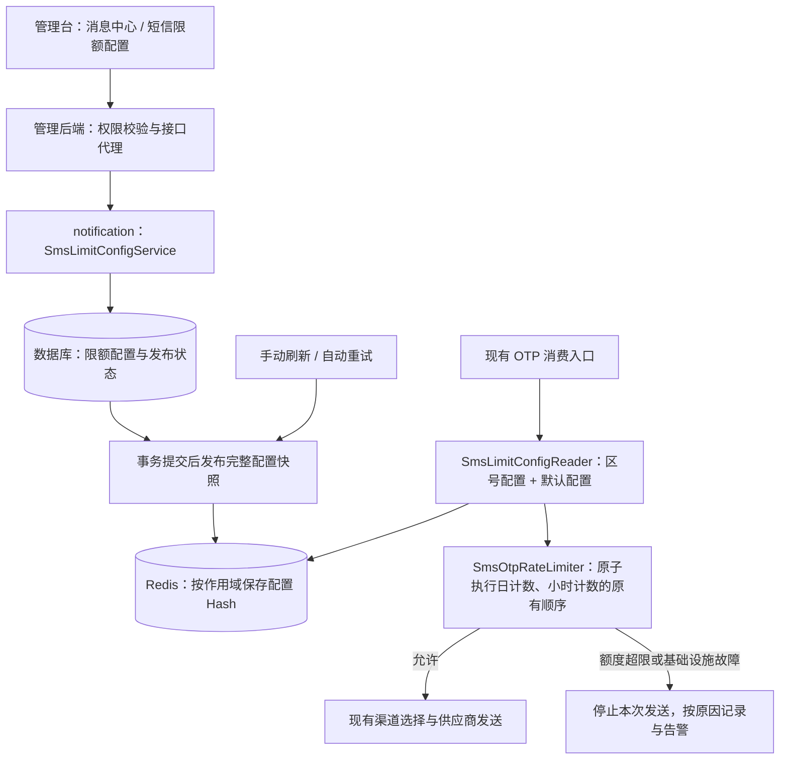

# 短信限额迁移解决方案

日期：2026-10-15。需求来源：[tem.md](C:/Users/erzhuochen/Desktop/笔记/tem.md)。现状证据见：[代码位置与执行流程](C:/Users/erzhuochen/Desktop/笔记/短信限额迁移-代码位置与执行流程.md)。本文是供评审的设计方案，未修改业务代码或操作运行环境。

## 1. 目标与范围

将 OTP 短信的区号日／小时限额从 Nacos 迁移到数据库，由管理台“消息中心”维护；发送端按区号读取 Redis 配置，通过原子计数判断是否允许发送。

已确认：

1. 只覆盖当前 `NotifyDoController.otpSms()` 链路，不扩展普通短信、华为 OTP 等其他入口。
2. 保留区号专属配置与全局默认配置，默认限额一起迁移。
3. 保存后自动刷新缓存，同时提供手动刷新。
4. 同时修复首次计数和并发计数问题，继续按自然日／自然小时统计。
5. 缓存与 DB 都无法提供可用配置时，停止当前 OTP 发送并告警。
6. DB 已保存、缓存刷新失败时，显示“已保存，待刷新”，自动重试；刷新成功后显示“已生效”。
7. 允许日／小时限额为 0，任一为 0 即停止该区号发送。
8. 允许短暂暂停 OTP 消费及直达入口，迁移计数后统一切换。
9. 计数口径沿用原代码：供应商发送前计数，发送失败不退计数，同次备用发送不重复计数；先更新日计数再检查小时限额，小时拦截不回退日计数。

本轮业务决策已收口。计数修复限于此前确认的首次计数与并发原子性；不引入“预占 → 成功确认／失败释放”流程，也不为本需求改造供应商发送结果。这里的计数是原有限额判断流程的累计次数，不是最终送达数或供应商受理成功数。

## 2. 总体设计

建议由 `wt-notification` 统一承载限额业务、DB 访问、配置缓存发布与计数。管理台后端负责页面接入、操作权限和代理内部接口。这样配置持久化、重试和发送端共享一套规则及 Redis 连接，避免管理端与通知端分别维护刷新逻辑。

管理台仓库尚未包含在当前工作区；管理端类名、菜单和权限接入位置需在该仓库核实。notification 已有 DB、事务管理器及 Redis 基础设施，不需要新增一个独立服务。



配置阈值、发送计数使用独立命名空间。刷新阈值不清理计数；配置改小后，后续检查使用新阈值，已累计计数保留。

部署作用域沿用现有环境／区域的隔离边界，不把多个原本独立的 Redis 计数合并成全球总量。新增 `scope_code` 标识该边界，由部署配置确定，不能由前端任意指定。当前本地代码支持 Redis standalone 与 cluster，但实际部署模式和作用域映射需上线前核实。

## 3. 数据模型

建议使用两张表。表名和字段名是拟议命名。

### 3.1 sms_limit_config：限额配置

| 字段 | 建议类型 | 说明 |
| --- | --- | --- |
| `id` | BIGINT | 主键 |
| `scope_code` | VARCHAR(64) | 当前环境／区域作用域 |
| `area_code` | VARCHAR(16) | 标准区号，例如 `+44`；`__DEFAULT__` 代表默认记录 |
| `day_limit` | INT UNSIGNED，可空 | 日限额；区号记录为 NULL 表示此维度继承默认值 |
| `hour_limit` | INT UNSIGNED，可空 | 小时限额；区号记录为 NULL 表示此维度继承默认值 |
| `row_version` | BIGINT | 编辑乐观锁版本，防止覆盖他人修改 |
| `created_by` / `updated_by` | VARCHAR(64) | 操作人 |
| `created_at` / `updated_at` | DATETIME | 创建／修改时间 |

唯一索引：`UNIQUE(scope_code, area_code)`。

每个作用域必须有且仅有一条默认记录，默认记录的两个限额都必填。区号记录允许每个维度独立选择“继承默认”或“指定数值”；界面选择“指定数值”时不允许留空。这样能保留现有两个 Nacos JSON 分别覆盖日／小时限额的行为，修改默认值时，继承的维度也会随之生效。

0 已确认为明确禁发，不作为缺失值处理。负数、非整数、超过 Java Integer 范围的数值拒绝保存。区号记录两维都继承时可直接使用默认配置，无需新增空记录。本次不增加删除／启停功能。

### 3.2 sms_limit_publish_state：发布状态与重试进度

| 字段 | 说明 |
| --- | --- |
| `scope_code` | 主键，每个作用域一条记录 |
| `desired_version` | DB 当前配置整体版本，每次配置变更递增 |
| `published_version` | 最近一次确认发布成功的版本，用于记录进度 |
| `retry_count` / `next_retry_at` | 自动重试进度 |
| `last_error` / `last_published_at` | 最近错误摘要与发布时间 |

限额变更和 `desired_version` 更新必须在同一 DB 事务中完成，因此进程在提交后崩溃，也能找到待发布的配置。`published_version` 只是历史确认值；实时生效状态还必须结合 Redis 实际版本，不能只看 DB 状态字段。

## 4. 配置缓存设计

推荐一个作用域对应一个 Redis Hash，区号作为 field，日／小时值放在同一个 field 中：

```text
key: sms:otp:limit:cfg:{scope_code}

field __schema__  → 1
field __version__ → 42
field __DEFAULT__ → {"dayLimit":20000,"hourLimit":500}
field +94         → {"dayLimit":1000,"hourLimit":200}
field +44         → {"dayLimit":1000,"hourLimit":null}
```

上述数值仅为说明结构的示例，不作为线上初始化值。

这仍然是按“配置 key + 区号”直接取阈值：一次 `HMGET` 读取区号 field、默认 field、版本和结构标记，再分别解析日／小时的继承关系。一次读取同时获得日／小时配置，避免两个方法分别查询时读到不同发布版本。[Redis HMGET 官方说明](https://redis.io/docs/latest/commands/hmget/)。

选择 Hash 完整快照，是为了让“区号 field 不存在”明确表示“本次完整配置中没有专属值”。如果改用每区号一个独立 key，key 被淘汰和从未配置会变得难以区分，不能简单在 miss 时就套默认值。

读取规则：

1. 快照结构、版本、默认值有效：区号专属维度有值就使用，没有就取相应默认值；0 不能当成空值。
2. 整个快照缺失、结构损坏或默认配置缺失：视为配置缓存不可用，受控地从 DB 重建完整快照，不能直接把缺失解释为“无限额”或套代码默认值。
3. 同一作用域的重建请求合并并限频，避免攻击请求同时击穿 DB；重建成功后重读，失败则按配置不可用停止本次发送并告警。
4. Redis 连接故障时，即使 DB 能提供阈值，也无法安全执行 Redis 原子计数，因此仍停止本次发送。DB 回源主要解决快照丢失／损坏且 Redis 本身可用的情况。

正式配置 Hash 不设置短 TTL，靠版本发布更新；临时构建 key 设置清理 TTL。使用共享连接工厂创建专用字符串序列化模板，保存 JSON 文本和数字字符串，不修改当前全局 `RedisService` 的序列化规则。

## 5. 保存、刷新与一致性

保存流程：

```text
校验入参和权限
  → 开启 DB 事务，锁定当前作用域的发布状态行
  → 按 row_version 新增／修改限额记录
  → desired_version + 1，标记待发布
  → 提交 DB 事务
  → 尝试发布最新完整快照
      → 成功且实际版本追上 DB：已生效
      → 失败：已保存，待刷新；进入持久化自动重试
```

notification 的现有事务管理器为 [DataSource1Config.java:67](D:/workspace/wh/wt/wt-notification/src/main/java/com/wotransfer/notification/configuration/DataSource1Config.java:67) 的 `wt_dbTransactionManager`。Redis 不在该 DB 事务里；不能用“抛异常回滚 DB”来假装实现跨 DB／Redis 原子事务。

完整快照发布流程：

1. 在一致性 DB 读取中获取配置列表和对应整体版本。构建期间短暂锁定同作用域状态行，确保版本与数据匹配；Redis 写入放在事务外。
2. 校验默认记录、区号唯一性、每个维度的有效值和结构，构建临时 Hash。
3. 临时 key 使用与正式 key 相同的 `{scope_code}` hash tag，例如 `sms:otp:limit:cfg:{scope_code}:tmp:<uuid>`。
4. 用短 Lua 脚本先检查临时快照完整性与正式版本：旧版本不得覆盖较新版本；符合条件时去掉临时 TTL，再 `RENAME` 切换到正式 key。整个切换不暴露“先删后写”的空档。[Redis Lua 原子执行说明](https://redis.io/docs/latest/develop/programmability/eval-intro/)、[RENAME 的 Cluster 同槽要求](https://redis.io/docs/latest/commands/rename/)。
5. 确认 Redis 实际版本后更新发布进度。确认阶段失败时可重复执行，不重复修改业务配置。

自动重试扫描 DB 中的待发布作用域，采用退避与失败告警；进程重启后继续。周期性核对 Redis 实际版本，发现正式 key 丢失时也能重建，不能只扫描 `desired_version > published_version`。手动刷新复用同一发布流程，不改变配置、不清计数。

管理台显示 `desiredVersion`、`effectiveVersion` 和 `syncStatus`。只有 Redis 可读、快照有效且版本追上 DB 才显示“已生效”；连接不可用显示“状态未知／待刷新”。多个管理员并发保存时，以当前作用域最新整体版本为准。

生效边界：发布成功后新开始的配置读取使用新快照；已经读取旧配置或已通过限额检查的在途请求不会被追溯撤销。不存在的区号与独立维度的默认继承使用同一快照。

## 6. 日／小时原子计数

新增 `SmsOtpRateLimiter`，在供应商发送前通过一个短 Lua 脚本原子执行原有的日／小时检查与计数顺序。发送后的成功、失败、异常结果均不回退计数，同次备用渠道发送不再次计数。原子化保证并发请求之间不穿插执行，不代表日计数和小时计数必须同时增加。

计数 key 示例：

```text
sms:otp:count:{scope_code:+44}:day:20261015
sms:otp:count:{scope_code:+44}:hour:2026101514
```

同一区号的两个 key 使用相同 hash tag，保证 Cluster 中落在同一个 slot；阈值作为脚本参数传入，不跨 slot 读取配置 Hash。[Redis Cluster hash tag 规则](https://redis.io/docs/latest/operate/oss_and_stack/reference/cluster-spec/)。

Lua 逻辑：

```text
先校验参数、两个计数 key 的数据类型与数值
dayCount  = 当前日计数，不存在按 0
hourCount = 当前小时计数，不存在按 0

dayLimit 为 0 或 dayCount >= dayLimit
    → 日限额拦截，两者均不增加
否则
    → 日计数 +1，按原规则设置 TTL

hourLimit 为 0 或 hourCount >= hourLimit
    → 小时限额拦截，保留本次日计数增加，小时计数不增加
否则
    → 小时计数 +1，按原规则设置 TTL，允许发送
```

这会修复首次写 0 仍放行和并发 get/set 丢增量的问题；小时拦截仍增加日计数这一原有行为保留。因此日计数可能大于实际进入供应商发送的请求数。脚本是短的固定逻辑，所有访问 key 通过 `KEYS` 显式传入；错误或超时不得当成计数为 0，也不盲目重跑可能已经执行的计数脚本。

日／小时边界继续沿用当前业务时区，上线前从运行环境核实并显式统一；用一次取时计算两个桶。新桶首次通过对应限额检查后计为 1；TTL 保持原规则，日计数写入时设置 86400 秒、小时计数写入时设置 3600 秒，每次对应计数更新时续期。自然时间窗口由 key 中的日期／小时决定，TTL 用于旧桶清理。0 和日期切换要单独验证。

额度超限与 Redis／配置故障返回不同原因，分别记录和告警。供应商返回值、备用渠道触发条件及结果处理保持原有调用方式；本次不增加成功确认、失败释放、发送回执结算或验证码跨故障长期重发机制。

代码现状旁注，仅记录证据，不纳入本次供应商改造：

- [SmsTelesignServiceImpl.java:60](D:/workspace/wh/wt/wt-notification/src/main/java/com/wotransfer/notification/service/impl/SmsTelesignServiceImpl.java:60) 和 [SmsYimeiServiceImpl.java:59](D:/workspace/wh/wt/wt-notification/src/main/java/com/wotransfer/notification/service/impl/SmsYimeiServiceImpl.java:59) 记录底层布尔结果后，仍固定返回 `SUCCESS_CODE`；底层 false 不等于调用方能看到失败。
- [SmsTencentCloudServiceImpl.java:64](D:/workspace/wh/wt/wt-notification/src/main/java/com/wotransfer/notification/service/impl/SmsTencentCloudServiceImpl.java:64) 将 SDK 异常统一转换成 `FAIL`，没有透出是否已提交、是否超时。
- [NotifyDoController.reSendSms():235](D:/workspace/wh/wt/wt-notification/src/main/java/com/wotransfer/notification/controller/NotifyDoController.java:235) 返回 void，忽略备用通道结果，无法汇总“所有通道明确未受理”。

上述现状说明不能把当前计数展示为“供应商成功发送条数”。按用户本轮确认，本次沿用原计数口径，不新增发送结果类型或额度释放流程。

只在限额服务内部规范化区号用于配置读取和计数，例如 `44` 与 `+44` 统一；不直接改写用于现有供应商路由的 DTO 字段，避免附带改变渠道行为。迁移时发现同一区号多种写法的配置值冲突，必须先报告冲突，不能静默覆盖。

## 7. 接口与管理台

下列路径是 notification 内部接口建议，管理台后端按既有规范代理；权限校验和内部调用鉴权复用各项目现有机制。

| 接口 | 用途 |
| --- | --- |
| `GET /internal/sms-limit-configs` | 默认配置、区号列表、配置版本、生效状态 |
| `POST /internal/sms-limit-configs` | 新增区号记录，成功提交后自动发布 |
| `PUT /internal/sms-limit-configs/{id}` | 修改默认／区号记录，携带 `rowVersion` 防覆盖 |
| `POST /internal/sms-limit-configs/refresh` | 从 DB 手动重新发布完整快照 |
| `GET /internal/sms-limit-configs/sync-status` | 查询实际生效版本、待刷新状态和错误摘要 |

管理台增加“消息中心 → 短信限额配置”。默认配置固定展示；区号记录展示日限额、小时限额，以及每维是指定值还是继承默认。支持区号查询、新增、修改和刷新；0 显示为“停止发送”，不显示成未配置。

保存返回至少包含 `saved`、`desiredVersion`、`effectiveVersion`、`syncStatus`、可读提示。DB 已提交而缓存失败时明确显示“已保存，待刷新”，不能提示“发送端已生效”，也不应让用户误以为未保存而重复新增。并发编辑冲突时返回版本冲突并要求重新加载。

## 8. 代码改动清单

| 位置 | 变更 |
| --- | --- |
| [NotifyDoController.java:143](D:/workspace/wh/wt/wt-notification/src/main/java/com/wotransfer/notification/controller/NotifyDoController.java:143) | `otpSms()` 中读取一次完整限额，再调用原子计数服务；保留日先计数、小时后检查的顺序，以及现有渠道选择、重发和供应商调用链 |
| [NotifyDoController.java:374](D:/workspace/wh/wt/wt-notification/src/main/java/com/wotransfer/notification/controller/NotifyDoController.java:374) | 替换／移除两个解析 Nacos JSON 的私有方法，避免日、小时分别读取配置 |
| [SmsConfig.java:36](D:/workspace/wh/wt/wt-notification/src/main/java/com/wotransfer/notification/configuration/SmsConfig.java:36) | 迁移稳定后移除四项限额属性；供应商、重发渠道和告警接收人配置继续保留用途 |
| `notification/pojo/model`、`dao`、`resources/mybatis/mapper` | 拟新增限额配置、发布状态的实体与 Mapper；需同时提交建表／初始化脚本 |
| `notification/service` | 拟新增 `SmsLimitConfigService`、`SmsLimitConfigReader`、`SmsLimitCachePublisher`、`SmsOtpRateLimiter` |
| `notification/controller` | 拟新增内部配置管理接口 |
| `notification/configuration`、`resources` | 拟新增专用字符串 Redis 模板、Lua 脚本及发布重试任务 |
| 管理台仓库 | 待定位：页面、菜单、权限、后端代理及 DTO |
| `wt-web` 登录验证码与 MQ 生产主链路 | 无需因阈值迁移改变请求入口或队列 |

上述 Java 类位于 `D:/workspace/wh/wt/wt-notification/src/main/java/com/wotransfer/notification/` 下对应包；XML、脚本和 SQL 使用 `D:/workspace/wh/wt/wt-notification/src/main/resources/` 下对应资源目录。拟新增项并非已经存在的类。

## 9. 初始化与上线切换

已确认允许采用短暂切换窗口。

1. 核对每个环境／区域的 DB、Redis、业务时区和有效 Nacos 限额。合并实际生效的默认值与两份区号 JSON，不能直接使用 Java 默认值初始化线上。
2. 导入 DB：按日／小时 JSON 区号并集建记录；缺失维度保留继承默认；规范化区号并检测重复冲突。初始化发布状态和默认记录。
3. 提前部署新配置管理与缓存代码，发送仍走旧逻辑；发布完整快照，对比各区号与默认值的最终结果。预演不修改发送计数。
4. 暂停所有相关 OTP 消费实例及直达消费方法的 HTTP 调用，等待在途请求结束；MQ 中待消费消息保留。防止新旧消费者同时修改不同计数。
5. 保留／迁移当前日与小时计数到新 key。同一标准区号的旧格式桶合并；旧桶存在时，可按旧值加 1 修正首次写 0 的偏差。该转换只能修正已知偏差，不能恢复历史并发已经丢失的增量，且旧日计数可能包含被小时拦截的请求。迁移需留明细，重复执行不得叠加计数。
6. 统一切换所有消费者到新配置与原子计数逻辑，核对版本和计数后恢复。切换不允许直接清空现有计数；不要在切换窗口跨整点／午夜而未处理桶变化。
7. 验证保存后生效、待刷新重试、0／默认继承、限额拦截和供应商发送情况。稳定后删除旧 Nacos 限额及兼容分支。

回滚必须考虑计数和配置来源。优先保留新原子计数能力，仅回滚外围变更；如必须回到完整旧版本，应冻结配置修改、暂停消费、将最新有效阈值及当前计数回迁，再统一恢复，不能简单切回空的旧计数桶。

## 10. 验证与验收

| 场景 | 预期 |
| --- | --- |
| 未配置区号、日／小时分别继承 | 正确使用同一快照中的默认维度；默认修改后继承值随之改变 |
| 区号专属配置 | 覆盖对应默认值，日／小时读取版本一致 |
| 阈值为 0 | 日为 0 时直接拦截、不增加计数；小时为 0 且日检查通过时，日计数增加后拦截，小时计数不增加 |
| 首次发送、N 条临界值 | 首次通过对应检查后计 1；串行及并发均不因首次偏差或丢增量额外放行 |
| 小时超限但日未超限 | 不发送；保留本次日计数增加，小时计数不增加，与原顺序一致 |
| 供应商失败与备用渠道 | 失败不回退日／小时计数，同次备用发送不重复计数；不改变既有返回结果和备用触发规则 |
| 修改配置与手动刷新 | 计数保留；新读取使用新版本；旧发布任务不能覆盖新版本 |
| DB 保存后 Redis 失败，进程重启 | DB 保留修改，界面显示待刷新；重启后自动重试 |
| 配置 Hash 丢失、默认字段缺失 | 触发受控重建，不误当作无专属配置而放宽限额 |
| Redis 不可用或脚本错误 | 停止本次发送，记录基础设施原因，不按计数 0 放行 |
| 并发编辑与并发刷新 | 不覆盖他人更新，不发布旧快照覆盖新版本 |
| 自然日／小时切换及计数迁移 | 新桶按正确边界生效，迁移不清额度、不重复叠加 |

观察指标：配置 DB 版本与 Redis 实际版本差距、刷新失败／重试、日／小时拦截量、配置及计数故障量。基础设施故障告警不能只依赖同一个故障 Redis 或受限的 OTP 发送路径。

后续进入实施前，需要补齐管理台仓库及部署事实。本文提及的类名、表名、接口路径是建议设计，不代表当前代码已经实现。
