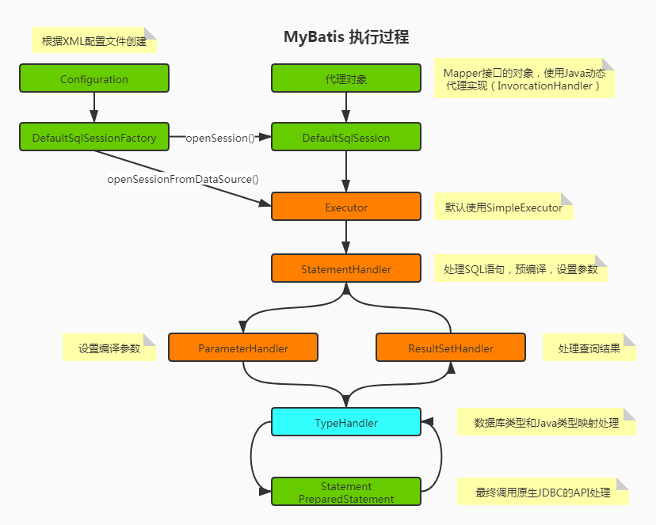
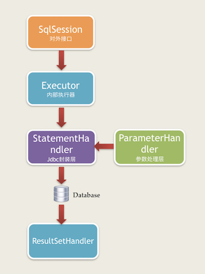

# 1. 基础介绍
## 1.1. 核心对象
从MyBatis代码实现的角度来看，MyBatis的主要的核心部件有以下几个：

- Configuration：初始化基础配置，比如MyBatis的别名等，一些重要的类型对象，如插件，映射器，ObjectFactory和typeHandler对象，MyBatis所有的配置信息都维持在Configuration对象之中。
- SqlSessionFactory：SqlSession工厂。
- SqlSession：作为MyBatis工作的主要顶层API，表示和数据库交互的会话，完成必要的数据库增删改查功能。
- Executor：MyBatis的内部执行器，它负责调用StatementHandler操作数据库，并把结果集通过ResultSetHandler进行自动映射，另外，它还处理二级缓存的操作。
- StatementHandler：MyBatis直接在数据库执行SQL脚本的对象。另外它也实现了MyBatis的一级缓存。
- ParameterHandler：负责将用户传递的参数转换成JDBC Statement所需要的参数。是MyBatis实现SQL入参设置的对象。
- ResultSetHandler：负责将JDBC返回的ResultSet结果集对象转换成List类型的集合。是MyBatis把ResultSet集合映射成POJO的接口对象。
- TypeHandler：负责Java数据类型和JDBC数据类型之间的映射和转换。
- MappedStatement：MappedStatement维护了一条<select|update|delete|insert>节点的封装。
- SqlSource ：负责根据用户传递的parameterObject，动态地生成SQL语句，将信息封装到BoundSql对象中，并返回。
- BoundSql：表示动态生成的SQL语句以及相应的参数信息。

## 1.2. 执行过程


# 2. 实现步骤
写一个实现org.apache.ibatis.plugin.Interceptor接口的拦截器类，并实现其中的方法。
1. 添加@Intercepts注解，写上需要拦截的对象和方法，以及方法参数。
2. Spring项目注意添加@Component注解即可，使其成为Spring管理的一个Bean。
## 2.1. 添加注解
MyBatis拦截器默认可以拦截的类 型只有四种，即四种接口类型Executor、StatementHandler、ParameterHandler和ResultSetHandler。对于我们的自定义拦截器必须使用MyBatis提供的@Intercepts注解来指明我们要拦截的是四种类型中的哪一种接口。

|注解|描述|
|:--|:--|
|`@Intercepts`|标志该类是一个拦截器|
|`@Signature`|指明该拦截器需要拦截哪一个接口的哪一个方法|

`@Signature`注解的参数：

| 参数     | 描述                                                                     |
| ------ | ---------------------------------------------------------------------- |
| type   | 四种类型接口中的某一个接口，如Executor.class。                                         |
| method | 对应接口中的某一个方法名，比如Executor的query方法。                                       |
| args   | 对应接口中的某一个方法的参数，比如Executor中query方法因为重载原因，有多个，args就是指明参数类型，从而确定是具体哪一个方法。 |
```java
@Intercepts({
    @Signature(type = Executor.class, method = "query", args = {MappedStatement.class, Object.class, RowBounds.class, ResultHandler.class}),
    @Signature(type = StatementHandler.class, method = "prepare", args = {Connection.class, Integer.class}),
    @Signature(type = ParameterHandler.class, method = "setParameters", args = {PreparedStatement.class}),
    @Signature(type = ResultSetHandler.class, method = "handleResultSets", args = {Statement.class})
})
```

### 2.1.1. type

`MyBatis`拦截器默认会按顺序拦截以下的四个接口中的所有方法：
```java
org.apache.ibatis.executor.Executor  //拦截执行器方法
org.apache.ibatis.executor.statement.StatementHandler  //拦截SQL语法构建处理
org.apache.ibatis.executor.parameter.ParameterHandler  //拦截参数处理
org.apache.ibatis.executor.resultset.ResultSetHandler  //拦截结果集处理
```

具体是拦截这四个接口对应的实现类：

```
org.apache.ibatis.executor.CachingExecutor
org.apache.ibatis.executor.statement.RoutingStatementHandler
org.apache.ibatis.scripting.defaults.DefaultParameterHandler
org.apache.ibatis.executor.resultset.DefaultResultSetHandler
```



### 2.1.2. method

这个可以根据`MyBatis`源码了解下。

### 2.1.3. args

根据参数类型区分重载的方法。


## 2.2. 方法实现

### 2.2.1. intercept

进行拦截的时候要执行的方法。该方法参数`Invocation`类中有三个字段：
```java
  private final Object target;
  private final Method method;
  private final Object[] args;
```

可通过这三个字段分别获取下面的信息：
```java
Object target = invocation.getTarget();//被代理对象
Method method = invocation.getMethod();//代理方法
Object[] args = invocation.getArgs();//方法参数
```

| 拦截接口             | 接口实现类                   |
| ---------------- | ----------------------- |
| Executor         | CachingExecutor         |
| StatementHandler | RoutingStatementHandler |
| ParameterHandler | DefaultParameterHandler |
| ResultSetHandler | DefaultResultSetHandler |
