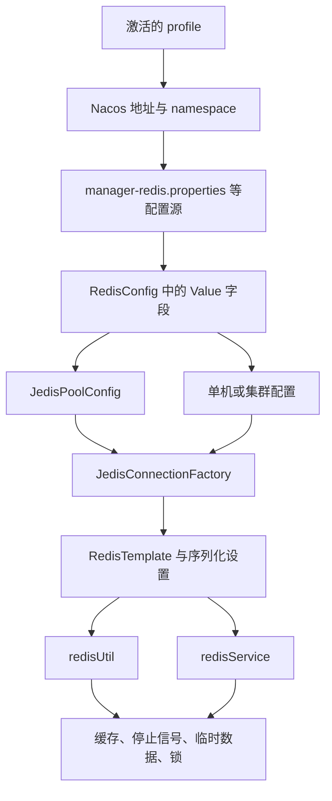

# manager-data 的 Redis 配置与使用学习笔记

整理日期：2026-10-16。面向已经了解 Redis 基本命令和 Spring Boot、希望读懂本项目实现的读者。

代码范围：`D:/workspace/wh/manager/manager-data`。文中的源码链接使用本机绝对路径和核对时的行号。

本文依据本地源码及本机 Maven 缓存中的实际依赖整理；未启动应用、未连接 Redis 或 Nacos。真实环境的 Redis 地址、密码、部署模式和连接池取值，需要到对应环境的 Nacos 中确认。下文的配置示例均为教学示例。

建议先读第 1～5 节，建立从配置到业务的完整路径；再用第 6～9 节对照代码复习。

## 1. 先认识项目里的几个角色

这个模块使用 **Spring Data Redis + Jedis**，在业务层主要通过两个自定义工具类调用 Redis。

| 层次 | 本项目中的名称 | 负责什么 |
| --- | --- | --- |
| 配置来源 | Nacos 的 `manager-redis.properties` 等配置源 | 提供连接地址、密码、连接池参数 |
| Redis 客户端 | Jedis | 与 Redis 服务端通信 |
| 连接池 | `JedisPoolConfig` | 控制连接数量、借还连接时的校验、空闲检测 |
| Spring 连接工厂 | `JedisConnectionFactory` | 按单机或集群配置提供连接 |
| 操作模板 | `RedisTemplate<String, Object>` | 提供 String、Hash、List 等操作，并负责序列化 |
| 工具类一 | `com.wotransfer.shiro.utils.RedisUtil`，Bean 名 `redisUtil` | 封装常用操作和一套锁实现 |
| 工具类二 | `com.wotransfer.core.redis.RedisService`，Bean 名 `redisService` | 封装常用操作、前缀匹配及另一套锁 API |
| 业务层 | Controller、Service、异步任务 | 决定 Key 怎么命名、存什么、何时过期和更新 |

[pom.xml:108](D:/workspace/wh/manager/manager-data/pom.xml:108) 引入 `spring-boot-starter-data-redis`，排除了 `lettuce-core`，并显式引入 `jedis`。父项目是 Spring Boot 3.2.4，见 [pom.xml:14](D:/workspace/wh/manager/manager-data/pom.xml:14)。

本模块主源码未检出 `@EnableCaching`、`@Cacheable`、`@CachePut`、`@CacheEvict`。学习入口应放在显式调用 `redisUtil`、`redisService` 的代码上。

下面表示依赖关系，不表示配置类扫描的先后顺序：



注意：项目有两处同名 `RedisTemplate` Bean 定义，第 3 节会说明它们为什么不能简单理解为两套独立模板。

## 2. Redis 配置从哪里来

### 2.1 从 profile 找到 Nacos 配置

入口是 [bootstrap.properties:14](D:/workspace/wh/manager/manager-data/src/main/resources/bootstrap.properties:14)。本地文件默认激活 `local`；部署脚本又会通过启动参数传入环境，见 [deploy.sh:105](D:/workspace/wh/manager/manager-data/deploy.sh:105)：

```text
--spring.profiles.active=${ENV}
```

接着，配置根据激活的 profile 选取 Nacos 地址和 namespace，见 [bootstrap.properties:72](D:/workspace/wh/manager/manager-data/src/main/resources/bootstrap.properties:72)：

```properties
spring.cloud.nacos.config.server-addr=${spring.profiles.active.${spring.profiles.active}.nacos.addr}
spring.cloud.nacos.config.namespace=${spring.cloud.nacos.config.${spring.profiles.active}.namespace}
```

Redis 配置以共享配置的形式引入，见 [bootstrap.properties:46](D:/workspace/wh/manager/manager-data/src/main/resources/bootstrap.properties:46)：

```properties
spring.cloud.nacos.config.shared-configs[3].data-id=manager-redis.properties
spring.cloud.nacos.config.shared-configs[3].refresh=true
```

同一文件第 38～39 行还保留了包含 `manager-redis.properties` 的旧式 `shared-dataids`、`refreshable-dataids` 配置。

本地资源中未找到这批 Redis 参数的实际取值。因此，阅读仓库可以确定“程序读取哪些字段、怎么使用”，但不能确定当前部署环境最终连接哪台 Redis。环境变量、启动参数和其他配置源也应结合实际启动方式检查，不能把某个文件的值直接当成运行时最终值。

### 2.2 连接配置项

字段定义见 [RedisConfig.java:51](D:/workspace/wh/manager/manager-data/src/main/java/com/wotransfer/dataManagement/config/RedisConfig.java:51)。

| 配置项 | Java 类型 | 本类声明的默认值 | 在本项目中的用途 |
| --- | --- | --- | --- |
| `spring.redis.host` | `String` | 无 | 单机地址 |
| `spring.redis.port` | `int` | 无 | 单机端口 |
| `spring.redis.password` | `String` | 无 | 单机和集群都使用的认证密码 |
| `spring.redis.nodes` | `String` | 空字符串 | 非空时进入集群分支，格式为逗号分隔的 `host:port` |
| `spring.redis.database` | `int` | `0` | 单机分支使用的数据库编号 |

这里的“无默认值”表示 `@Value` 占位符没有写回退值，必须能从配置环境中解析出来；不等于密码必须非空。

尤其注意：`host`、`port`、`password` 都是字段注入，即使最后进入集群分支，也不能因为单机地址不参与连接就省掉这些占位符所需的配置。

本类通过 `@Value("${spring.redis.host}")` 等表达式明确读取这些名称。学习时以代码中的名称为准，不能直接把别的 Spring Boot 示例中的属性前缀替换进来。

### 2.3 连接池配置项

字段定义见 [RedisConfig.java:30](D:/workspace/wh/manager/manager-data/src/main/java/com/wotransfer/dataManagement/config/RedisConfig.java:30)，应用参数见 [RedisConfig.java:73](D:/workspace/wh/manager/manager-data/src/main/java/com/wotransfer/dataManagement/config/RedisConfig.java:73)。下列字段在本类中均未声明默认值。

| 配置项 | Java 类型 | 对应调用 | 含义 |
| --- | --- | --- | --- |
| `redis.maxTotal` | `int` | `setMaxTotal` | 连接池最多可管理的连接数 |
| `redis.maxIdle` | `int` | `setMaxIdle` | 池中最多保留的空闲连接数 |
| `redis.maxWait` | `int` | `setMaxWaitMillis` | 从连接池借连接的最大等待时间，单位为毫秒 |
| `redis.testOnBorrow` | `boolean` | `setTestOnBorrow` | 借出连接时是否校验连接 |
| `redis.testOnReturn` | `boolean` | `setTestOnReturn` | 归还连接时是否校验连接 |
| `redis.testWhileIdle` | `boolean` | `setTestWhileIdle` | 空闲检测时是否校验连接 |
| `redis.timeBetweenEvictionRunsMillis` | `long` | `setTimeBetweenEvictionRunsMillis` | 空闲资源检测任务的运行间隔，单位为毫秒 |

`maxWait` 是等待从池里借到连接的时间，不是 TCP 建连超时，也不是 Redis 命令读取超时。当前 `JedisClientConfiguration` 的构建代码只显式配置连接池，没有显式调用连接或读取超时设置，见 [RedisConfig.java:107](D:/workspace/wh/manager/manager-data/src/main/java/com/wotransfer/dataManagement/config/RedisConfig.java:107)。不能据此推断底层没有超时；它们可能采用依赖默认值。

源码第 86 行把 `testOnReturn` 注释成了空闲检查，但实际 setter 是“归还时校验”。阅读时应以调用的方法为准。

### 2.4 一份帮助理解字段的示例

下面的数字只是教学取值，不是仓库中查到的真实配置，也不代表生产调优建议。

```properties
# 单机示例：请使用自己的本地实例
spring.redis.host=127.0.0.1
spring.redis.port=6379
spring.redis.password=YOUR_LOCAL_PASSWORD
spring.redis.database=0
spring.redis.nodes=

# 自定义连接池字段，逐项对应 RedisConfig 中的 @Value
redis.maxTotal=20
redis.maxIdle=5
redis.maxWait=2000
redis.testOnBorrow=false
redis.testOnReturn=false
redis.testWhileIdle=true
redis.timeBetweenEvictionRunsMillis=30000
```

若学习集群分支，可把 `spring.redis.nodes` 理解为下面这种格式：

```properties
spring.redis.nodes=127.0.0.1:7001,127.0.0.1:7002,127.0.0.1:7003
```

这只是字段格式展示，不会把三个普通单机实例自动变成 Redis Cluster。

### 2.5 单机与集群的选择逻辑

见 [RedisConfig.java:107](D:/workspace/wh/manager/manager-data/src/main/java/com/wotransfer/dataManagement/config/RedisConfig.java:107) 和 [RedisConfig.java:128](D:/workspace/wh/manager/manager-data/src/main/java/com/wotransfer/dataManagement/config/RedisConfig.java:128)。

| 条件 | 创建连接工厂时使用的配置 | 读取哪些字段 |
| --- | --- | --- |
| `StringUtils.isNotEmpty(nodes)` 为 `false` | `RedisStandaloneConfiguration` | `host`、`port`、`password`、`database` |
| `StringUtils.isNotEmpty(nodes)` 为 `true` | `RedisClusterConfiguration` | `nodes`、`password`；最大重定向次数写死为 `6` |

集群节点字符串先按逗号拆分，再按冒号拆出主机和端口，代码没有 `trim()` 或完整格式校验。空格字符串也满足 `isNotEmpty`，所以“空字符串”和“只有空格”在这里不是同一种配置。

`database` 只在单机分支调用 `setDatabase`，集群分支未使用它。项目未展示 Sentinel 的配置分支。

## 3. Spring 如何把配置装配成可用对象

### 3.1 对照 Bean 看依赖关系

| Bean 名 | 定义位置 | 装配过程 |
| --- | --- | --- |
| `jedisPoolConfig` | `RedisConfig.jedisPoolConfig()` | 把 `redis.*` 字段放入 `JedisPoolConfig` |
| `jedisConfig` | `RedisConfig.jedisConfig()` | 组装 `RedisClusterConfiguration` |
| `JedisConnectionFactory` | `RedisConfig.JedisConnectionFactory(...)` | 组合客户端连接池配置，选择单机或集群模式 |
| `functionDomainRedisTemplate` | 两个配置类均有定义 | 设置连接工厂和序列化器 |
| `redisUtil` | `RedisConfig.redisService(...)` | 创建 `RedisUtil`，调用 `setRedisTemplate(...)` |
| `redisService` | `RedisTemplateConfig.redisService(...)` | 创建 `RedisService`，调用 `setRedisTemplate(...)` |

`redisUtil` 的工厂方法虽然也叫 `redisService`，但 `@Bean(name = "redisUtil")` 明确了实际 Bean 名。不要只根据方法名判断注入的是哪个工具类。

### 3.2 两个同名模板，事务开关有冲突

这是当前代码中最需要留意的一处配置现状：

| 定义 | Bean 名 | 事务支持设置 |
| --- | --- | --- |
| [RedisConfig.java:155](D:/workspace/wh/manager/manager-data/src/main/java/com/wotransfer/dataManagement/config/RedisConfig.java:155) | `functionDomainRedisTemplate` | 第 174 行调用 `setEnableTransactionSupport(false)` |
| [RedisTemplateConfig.java:22](D:/workspace/wh/manager/manager-data/src/main/java/com/wotransfer/dataManagement/config/RedisTemplateConfig.java:22) | `functionDomainRedisTemplate` | 第 41 行调用 `setEnableTransactionSupport(true)` |

[bootstrap.properties:90](D:/workspace/wh/manager/manager-data/src/main/resources/bootstrap.properties:90) 又声明：

```properties
spring.main.allow-bean-definition-overriding=true
```

因此，这不是两个名称不同、可直接分别注入的模板；它们存在同名 Bean 覆盖关系。两个工具类的工厂方法也没有用 `@Qualifier` 指定各自独享的模板。

**仅凭当前静态代码，不能断言最终注入模板的事务开关是 true 还是 false。** 应结合实际启动的 Bean 定义、覆盖日志，以及调试时两个工具类中持有的模板实例确认。`RedisConfig` 中“开启事务”的注释和实际的 `false` 也不一致。

`setEnableTransactionSupport(true)` 只是模板参与 Spring 管理事务所需的设置之一；不能据此断定每个 Redis 调用都有事务，更不能据此认定数据库和 Redis 具备跨资源的原子提交保证。相关机制见 [Spring Data Redis 3.2.4：Redis Transactions](https://github.com/spring-projects/spring-data-redis/blob/3.2.4/src/main/antora/modules/ROOT/pages/redis/transactions.adoc)。

### 3.3 序列化：Java 对象怎样变成 Redis 数据

两份模板配置的序列化设置相同，见 [RedisConfig.java:169](D:/workspace/wh/manager/manager-data/src/main/java/com/wotransfer/dataManagement/config/RedisConfig.java:169) 和 [RedisTemplateConfig.java:36](D:/workspace/wh/manager/manager-data/src/main/java/com/wotransfer/dataManagement/config/RedisTemplateConfig.java:36)。

| 位置 | 序列化器 | 阅读 Redis 数据时的含义 |
| --- | --- | --- |
| Redis Key | `StringRedisSerializer` | 例如 `NZ_BANK_INFO`，按字符串编码 |
| Hash field | `StringRedisSerializer` | 例如银行编号拼接字段，按字符串编码 |
| 普通 value | `GenericJackson2JsonRedisSerializer` | Java 值以 JSON 方式序列化 |
| Hash value | `GenericJackson2JsonRedisSerializer` | 每个 field 对应的值以 JSON 方式序列化 |

`RedisTemplate<String, Object>` 的 `Object` 是 Java 层的类型，不表示 Redis 多了一种 Object 数据类型。普通 `set` 写入的底层 Redis 类型仍然是 String；`hset` 操作 Hash；`lSet` 操作 List。

项目有些调用先执行 `JSON.toJSONString(...)`，再交给模板的 JSON 序列化器。此时模板拿到的是“包含 JSON 文本的 Java String”，所以在命令行中可能看到额外的引号或转义；读取后仍可能需要业务层再次解析 JSON。银行信息案例就是这种情况。

## 4. 业务里为什么主要看到两个工具类

两个工具类都把 `RedisTemplate` 的操作包装成比较短的方法，但它们不是完全相同的 API，尤其不能混用锁参数的单位。

### 4.1 常见调用和 Redis 操作的对应关系

下表是便于理解的操作对应关系，不表示所有包装方法都只发出一条命令。

| Java 调用 | 对应的操作 | 时间或返回值需要怎样理解 |
| --- | --- | --- |
| `get(key)` / `set(key, value)` | GET / SET | 不带时间的普通 SET 不主动保留旧 TTL |
| `set(key, value, time)` | 设置值并指定有效期 | 这里两个工具类的 `time` 均为秒 |
| `hasKey(key)` | EXISTS | 适合检查停止信号是否存在 |
| `expire(key, time)` | EXPIRE | `time` 为秒；包装实现只在 `time > 0` 时调用过期操作 |
| `getExpire(key)` | TTL | 秒级剩余时间；不是“返回 0 就永久有效” |
| `hget(key, field)` / `hset(key, field, value)` | HGET / HSET | 无时间参数时，不主动重设已有 Key 的 TTL |
| `hset(key, field, value, time)` | HSET 后设置 EXPIRE | 秒；作用于整个 Hash Key，不是单个 field |
| `hdel(key, fields...)` | HDEL | 删除 Hash 中的指定字段 |
| `lSet(key, object, time)` | RPUSH 后设置 EXPIRE | 秒；Object 重载把整个对象作为一个 List 元素追加 |
| `lGet(key, start, end)` | LRANGE | `0, -1` 表示读取整个 List |
| `del(keys...)` | DEL | 删除指定 Key |
| `redisService.getKeys(prefix)` | KEYS，匹配 `prefix + "*"` | 是前缀匹配，不是 SCAN |
| `redisService.blurDel(prefix)` | KEYS 后批量删除 | 实际依赖中使用 `prefix + "**"`，效果为前缀通配，不是任意位置包含匹配 |

普通 SET 覆盖已有 Key 会清除原有 TTL；HSET、RPUSH 这类修改内部数据的操作通常保留原有 TTL。所以“这次调用没有传过期时间”不能一概解释为“这个 Key 永不过期”。基础语义见 [Redis EXPIRE 文档](https://redis.io/docs/latest/commands/expire/)。

另外，封装中的 `hset(..., time)`、`lSet(..., time)` 是先写数据，再独立设置过期时间。不能把一个 Java 方法调用直接等同于一个原子的 Redis 命令。部分封装还会捕获异常后返回 `false` 或 `null`，读业务代码时要一起看调用者是否检查结果。

### 4.2 锁方法：先确认类名，再确认单位

| 调用 | 时间参数含义 | Redis 中的有效期机制 |
| --- | --- | --- |
| `redisService.lock(key, 600)` | **秒**，这里为 10 分钟 | `setIfAbsent(..., TimeUnit.SECONDS)` |
| `redisUtil.lock(key, 5 * 60 * 1000)` | **毫秒逻辑锁期限**，这里为 5 分钟 | 值中记录到期时间，底层另有固定 5000 秒的 EXPIRE |
| `redisUtil.lock(key)` | 无参数时默认逻辑锁期限为 **500 毫秒** | 委托 `lock(key, 500)`，底层另有固定 5000 秒的 EXPIRE |
| `redisUtil.tryLock(key, waitTime)` | **毫秒等待时间** | 反复调用默认的 `lock(key)`，不是把持锁 TTL 设为 waitTime |

上述 `RedisUtil.lock(String, int)` 已按本机 `manager-jar:1.0.14` 的实际字节码核验。`RedisService.lock(String, long)` 已按本机 `core:3.0.1-SNAPSHOT` 的实际字节码核验。邻近源码并不包含所有相同重载，第 9 节说明了依赖版本边界。

不要把这两个 `lock(key, time)` 看成可以直接替换的方法。逻辑锁到期时间和 Redis Key 的 TTL 也不是同一个概念，不能仅通过 `TTL` 推断旧式锁值中的逻辑期限。

上表的 `lock` / `unlock` 都使用 `redis_lock_` 前缀。例如普通业务标记 `APPLY_ORDER_REFUND_REQUIRE{id}` 和锁 Key `redis_lock_APPLY_ORDER_REFUND_REQUIRE{id}` 是不同的 Key。实际依赖另外提供的 `redisService.setnx(key, value, time, timeUnit)` 原样使用传入的 Key，不自动添加这个前缀。

## 5. 沿五条实际业务链路学习

### 5.1 String + TTL：自动清分任务的停止信号

写入入口：[ApplyOrderController.autoClearStop](D:/workspace/wh/manager/manager-data/src/main/java/com/wotransfer/dataManagement/controller/ApplyOrderController.java:1978)。

```java
boolean stopAll = StringUtils.isEmpty(batch);
String taskKey = stopAll ? "autoClear-stop" : ("autoClear-stop-" + batch);
long expireSeconds = stopAll ? 300 : 24 * 60 * 60;
boolean redisSaved = redisUtil.set(taskKey, 1, expireSeconds);
```

| 停止范围 | Key | value | TTL |
| --- | --- | --- | --- |
| 全部任务 | `autoClear-stop` | `1` | 300 秒，即 5 分钟 |
| 指定批次 | `autoClear-stop-{batch}` | `1` | 86400 秒，即 24 小时 |

读取位置：[AsyncOrder.sendOrder](D:/workspace/wh/manager/manager-data/src/main/java/com/wotransfer/dataManagement/async/AsyncOrder.java:74)。异步循环在处理每条订单前检查批次信号和全局信号；任意一个存在，就把对应任务状态更新为 `STOP`，并继续循环处理下一条。

```java
if (redisUtil.hasKey(taskKey) || redisUtil.hasKey("autoClear-stop")) {
    // 将当前任务更新为 STOP
    continue;
}
```

这里 Redis 承担的是跨请求、跨执行线程可见的“协作信号”，不只是数据库查询缓存。判断依据是 Key 是否存在，不是 value 的具体内容。Controller 还会调用 `stopAutoClearBatch(batch)` 更新任务记录，因此也不能把整个停止流程理解为只有一次 Redis 写入。

### 5.2 数据库 → Redis：支持注册国家配置的主动刷新

入口：[SupportCountryController.refreshCache](D:/workspace/wh/manager/manager-data/src/main/java/com/wotransfer/dataManagement/controller/SupportCountryController.java:88)。实现见 [SupportCountryServiceImpl.refreshCache](D:/workspace/wh/manager/manager-data/src/main/java/com/wotransfer/dataManagement/service/impl/SupportCountryServiceImpl.java:119)。

```text
调用刷新接口
  → 数据库查询 status=ACTIVE 的国家
  → 查询结果非空时，删除 SUPPORT_COUNTRY_ 前缀下的旧 Key
  → 每个国家写入 SUPPORT_COUNTRY_{areaCode}
```

```java
redisService.blurDel("SUPPORT_COUNTRY_");
for (SupportCountry supportCountry : supportCountries) {
    redisService.set("SUPPORT_COUNTRY_" + supportCountry.getAreaCode(),
                     supportCountry.getAreaCode());
}
```

数据类型为 String；这个写入调用没有指定 TTL。它是“主动刷新生成配置缓存”的案例，本模块这段方法没有展示缓存命中、未命中后回源的完整读取流程。

另一个 [globalRefreshCache](D:/workspace/wh/manager/manager-data/src/main/java/com/wotransfer/dataManagement/service/impl/SupportCountryServiceImpl.java:136) 会在本地写入后调用 `PMMClient.syncRedis(...)` 同步到远端。远端如何落 Redis，需要继续查看接收服务。

读这段实现时还要观察两个边界：查询结果为空时不会清除旧 Key；删除旧缓存和逐项重建是多个操作，中间存在可见的空档。它们都是当前代码行为，不能直接当成原子刷新方案。

### 5.3 Hash：银行信息从 Excel 懒加载到 Redis

主要实现：[BankInfoInitConfig](D:/workspace/wh/manager/manager-data/src/main/java/com/wotransfer/dataManagement/config/BankInfoInitConfig.java:29)。业务调用位置：[AccountCheckServiceImpl.java:3156](D:/workspace/wh/manager/manager-data/src/main/java/com/wotransfer/dataManagement/service/impl/AccountCheckServiceImpl.java:3156)。

```text
业务调用 getBankInfo(bankAccount)
  → ensureLoaded()
  → 首次调用时读取 classpath 下 NZL_BANK_INFO.xlsx
  → 按银行编号与分行编号拼成 Hash field
  → hset 到 NZ_BANK_INFO
  → 按银行账号前 6 位执行 hget
```

| 部分 | 内容 |
| --- | --- |
| Redis Key | `NZ_BANK_INFO` |
| 数据类型 | Hash |
| field | Excel 中的 `Bank_Number + Branch_Number` |
| value | 包含 `bic`、`bankName`、`nationalClearingCode` 的 JSON 文本 |
| TTL | 此处 `hset` 没有设置 TTL |
| 读取方式 | `hget("NZ_BANK_INFO", bankAccount 前 6 位)` |

这里可以同时学习 Hash 和序列化：`bankInfo.toJSONString()` 先生成 Java String，模板再序列化它；`hget` 取回后，业务再通过 `JSONObject.parseObject(...)` 解析。

`AtomicBoolean loaded` 是当前 JVM 中的标记，不是 Redis 分布式锁。它也不是检查 Redis 缓存是否存在的标记：同一进程加载成功后，Redis 数据若丢失，当前代码不会因为 Hash 缺失就自动重置 `loaded`。因此“每个进程首次调用时加载”和“缓存不存在时自动回源”要分清楚。

### 5.4 Hash + 锁：国际化文案维护与全量刷新

日常维护见 [InternationalManagementServiceImpl.langMsgAdd](D:/workspace/wh/manager/manager-data/src/main/java/com/wotransfer/dataManagement/service/impl/InternationalManagementServiceImpl.java:143)：数据库插入或更新成功后，写入文案 Hash；删除和同步逻辑也会调用 `hdel`、`hset`。

```text
Hash Key = LANG_DICT_MSG，或 TOPUP 分支的 LANG_DICT_MSG_TOPUP
field    = {msgKey}+{langId}+{module}
value    = 对应语言的文案
```

这里的 `+` 是实际用于连接字段的字符。不同业务类型通过不同 Hash Key 区分；这一处写入调用没有指定 TTL。

刷新入口是 [InternationalManagementController.langMsgRefreshCache](D:/workspace/wh/manager/manager-data/src/main/java/com/wotransfer/dataManagement/controller/InternationalManagementController.java:215)：

```text
redisService.lock("langMsgRefreshCache", 600)
  → 未拿到锁时返回 WORKING_ERROR
  → 拿到锁后调用 internationalManagementService.langMsgRefreshCache()
  → Service 实际调用远端 commonClient.fresh()
  → 成功分支调用 unlock
```

Service 中的远端调用见 [InternationalManagementServiceImpl.java:270](D:/workspace/wh/manager/manager-data/src/main/java/com/wotransfer/dataManagement/service/impl/InternationalManagementServiceImpl.java:270)。不要把这条全量刷新链路误读为当前方法在本地遍历所有文案并 `hset`。

这一处 `redisService.lock` 会使用 `redis_lock_` 前缀，实际锁 Key 为 `redis_lock_langMsgRefreshCache`，超时参数 600 的单位是秒。

当前 Controller 只在成功分支解锁，没有在 `finally` 里统一释放；失败或异常后通常要等待该锁的有效期结束。实际依赖中的 `unlock` 直接删除前缀 Key，没有 owner token 校验。因此它适合用来认识项目现状，不宜直接照搬成严格的分布式锁模板：持锁任务超时后，旧任务存在删除后续持有者锁的风险。

### 5.5 先查缓存，未命中再回源：文章查询

完整读取入口在 [HomePageNewsController.queryArticleByTag](D:/workspace/wh/manager/manager-data/src/main/java/com/wotransfer/dataManagement/controller/HomePageNewsController.java:194)，写入在 [HomePageServiceImpl.selectArticleByTag](D:/workspace/wh/manager/manager-data/src/main/java/com/wotransfer/dataManagement/service/impl/HomePageServiceImpl.java:95)。

```text
请求进入 Controller
  → 规范化语言：zh / zh-hk 保留，其他语言按 en 处理
  → 拼接 MEDIA_ARTICLE_{page}_{limit}_{country}_{lang}
  → redisService.get(cacheKey)
  → 普通请求且命中：JSON.parseArray 后直接返回
  → 未命中或 flag=TASK-MEDIA：进入 Service 查询数据库
  → JSON.toJSONString(result) 后写入缓存，TTL 为 3600 秒
  → 返回查询结果
```

这是本模块比较完整的“缓存旁路”示例：缓存未命中时由业务代码负责回源并回填；`TASK-MEDIA` 请求会绕过缓存结果，重新生成数据。Controller 和 Service 共同构成这条链路，只读其中一个方法容易漏掉另一半。

Key 包含页码、每页数量、国家和语言，体现了缓存结果与查询条件的关系。学习类似设计时，应检查所有会改变结果的参数是否体现在 Key 或失效策略中。

### 5.6 补充案例：List + 短 TTL 保存 Excel 临时结果

代码见 [AccountCheckServiceImpl.importCzFile](D:/workspace/wh/manager/manager-data/src/main/java/com/wotransfer/dataManagement/service/impl/AccountCheckServiceImpl.java:236) 和 [importYlFile](D:/workspace/wh/manager/manager-data/src/main/java/com/wotransfer/dataManagement/service/impl/AccountCheckServiceImpl.java:260)。**这两个方法已标记 `@Deprecated`，作为补充学习案例阅读。**

```text
解析上传的 Excel
  → 生成 accountCheckImportFile{timestamp}
  → redisUtil.lSet(key, lists, 120)
  → 把 Key 返回给后续处理流程
  → 后续用 lGet(key, 0, -1) 读取
```

TTL 为 120 秒，即 2 分钟。这里的 `lists` 类型是 `List<List<String>>`；它匹配的是 `lSet(String, Object, long)` 重载，而不是 `lSet(String, List<Object>, long)`。所以它把“整张表对象”作为一个 Redis List 元素写入，并不是每一行各占一个元素。

这一点也能从 [后续读取代码](D:/workspace/wh/manager/manager-data/src/main/java/com/wotransfer/dataManagement/service/impl/AccountCheckServiceImpl.java:296) 验证：取 `lGet` 结果的第 0 项，再转换为 `List<List<String>>`。

学习重点是区分“Java 对象本身是 List”和“Redis 底层数据类型是 List”，以及从返回的 Key 串起两个阶段的处理流程。

## 6. 主要 Key 与 TTL 速查

下面整理代表性 Key 家族，便于找入口；不是所有跨服务读写位置的穷举。`未指定` 只描述所列写入调用，不表示其他服务不能修改或过期这个 Key。

| Key 或规则 | Redis 类型 | 所列调用的 TTL | 用途与源码入口 |
| --- | --- | --- | --- |
| `autoClear-stop` | String | 300 秒 | 全局停止信号；`ApplyOrderController:1982` |
| `autoClear-stop-{batch}` | String | 86400 秒 | 批次停止信号；`ApplyOrderController:1982` |
| `SUPPORT_COUNTRY_{areaCode}` | String | 未指定 | 国家配置缓存；`SupportCountryServiceImpl:128` |
| `NZ_BANK_INFO` | Hash | 未指定 | 银行信息字典；`BankInfoInitConfig:105` |
| `LANG_DICT_MSG` / `LANG_DICT_MSG_TOPUP` | Hash | 未指定 | 国际化文案；`InternationalManagementServiceImpl:160` |
| `redis_lock_langMsgRefreshCache` | String | 600 秒 | 文案全量刷新锁；`InternationalManagementController:218` |
| `accountCheckImportFile{timestamp}` | List | 120 秒 | 旧版 Excel 临时数据；`AccountCheckServiceImpl:245` |
| `MEDIA_ARTICLE_{page}_{limit}_{country}_{lang}` | String | 3600 秒 | 文章结果 JSON；[HomePageServiceImpl:95](D:/workspace/wh/manager/manager-data/src/main/java/com/wotransfer/dataManagement/service/impl/HomePageServiceImpl.java:95) |
| `feishuDelayOrder-{ticketId}` | String | 86400 秒 | 延迟订单处理信息；[GuessYouAskServiceImpl:461](D:/workspace/wh/manager/manager-data/src/main/java/com/wotransfer/dataManagement/service/impl/GuessYouAskServiceImpl.java:461) |
| `releaseRiskOrder-{serviceId}` | String | 259200 秒，即 3 天 | 风控放行相关记录；[GuessYouAskServiceImpl:596](D:/workspace/wh/manager/manager-data/src/main/java/com/wotransfer/dataManagement/service/impl/GuessYouAskServiceImpl.java:596) |
| `STB_{pid}` | String | 未指定 | 用户标识映射；[UsersServiceImpl:883](D:/workspace/wh/manager/manager-data/src/main/java/com/wotransfer/dataManagement/service/impl/UsersServiceImpl.java:883) |
| `LANG_DICT_KEY` | Hash | 未指定 | 语言字典，重建时删除后写入；[InternationalManagementServiceImpl:95](D:/workspace/wh/manager/manager-data/src/main/java/com/wotransfer/dataManagement/service/impl/InternationalManagementServiceImpl.java:95) |
| `COMMON_ENUM_MAP` | Hash | 未指定 | 枚举配置缓存；[CommonEnumServiceImpl:378](D:/workspace/wh/manager/manager-data/src/main/java/com/wotransfer/dataManagement/service/impl/CommonEnumServiceImpl.java:378) |
| `APPLICATION_MANAGER_INFO` | Hash | 未指定 | 按应用名称组织异常消息配置；[ExceptionMessageConfigServiceImpl:90](D:/workspace/wh/manager/manager-data/src/main/java/com/wotransfer/dataManagement/service/impl/ExceptionMessageConfigServiceImpl.java:90) |
| `GLC:CAPTCHA:UN_USEFUL_PHONE_NO_START` | String | 未指定 | 验证码拦截手机号前缀配置；[CaptchaInterceptConfigServiceImpl:70](D:/workspace/wh/manager/manager-data/src/main/java/com/wotransfer/dataManagement/service/impl/CaptchaInterceptConfigServiceImpl.java:70) |
| `COMMIT_JUMIO{userId}` | String | 60 秒 | 提交操作重复控制；[KycServiceImpl:768](D:/workspace/wh/manager/manager-data/src/main/java/com/wotransfer/dataManagement/service/impl/KycServiceImpl.java:768) |
| `change-payee-{id}` | String | 300 秒 | 修改收款人操作间隔控制；[ApplyOrderController:797](D:/workspace/wh/manager/manager-data/src/main/java/com/wotransfer/dataManagement/controller/ApplyOrderController.java:797) |
| `FILL_ORDER_OPERATE{seqNo或id}` | String | 10 秒 | 补汇操作重复控制；[FillOrderServiceImpl:85](D:/workspace/wh/manager/manager-data/src/main/java/com/wotransfer/dataManagement/service/impl/FillOrderServiceImpl.java:85) |
| `APPLY_ORDER_REFUND{refundId}` | String | 300 秒 | 退款处理标记；[ApplyOrderRefundController:518](D:/workspace/wh/manager/manager-data/src/main/java/com/wotransfer/dataManagement/controller/ApplyOrderRefundController.java:518) |
| `APPLY_ORDER_REFUND_REQUIRE{applyOrderId或userId}` | String | 300 秒 | 退款申请操作标记；[ApplyOrderRefundServiceImpl:839](D:/workspace/wh/manager/manager-data/src/main/java/com/wotransfer/dataManagement/service/impl/ApplyOrderRefundServiceImpl.java:839) |
| `WAIT_REFUND_RESULT-{applyOrderId或refundId}` | String | 259200 秒 | 等待下游退款结果，消费后删除；[AsyncJob:1390](D:/workspace/wh/manager/manager-data/src/main/java/com/wotransfer/dataManagement/async/AsyncJob.java:1390) |
| `web_chat_session_{date}` / `web_chat_message_{date}` | String，数值 | 未指定 | 消息推送统计，昨日统计入库成功后删除；[CustomerServiceServiceImpl:736](D:/workspace/wh/manager/manager-data/src/main/java/com/wotransfer/dataManagement/service/impl/CustomerServiceServiceImpl.java:736) |

文章缓存的读取在 Controller，数据库查询与写缓存在 Service；`STB_{pid}` 的读缓存、未命中查数据库、回填流程则集中在 `UsersServiceImpl.getSid`。两种组织方式都要沿调用者与被调用者连起来阅读。

常见锁 Key 可以另外对照：

| 实际 Key | 使用的 API 与时间含义 | 源码入口 |
| --- | --- | --- |
| `redis_lock_COMMON_ENUM_MAPrefresh` | `redisService.lock`，300 秒 TTL | [CommonEnumServiceImpl:237](D:/workspace/wh/manager/manager-data/src/main/java/com/wotransfer/dataManagement/service/impl/CommonEnumServiceImpl.java:237) |
| `redis_lock_CHANGE_SOURCE_SEQ_NO_{orderId}` | `redisService.lock`，30 秒 TTL | [WalletOrderServiceImpl:272](D:/workspace/wh/manager/manager-data/src/main/java/com/wotransfer/dataManagement/service/impl/WalletOrderServiceImpl.java:272) |
| `redis_lock_CHANGE_SOURCE_SEQ_NO_{seqNo}` | `redisUtil.lock`，300000 毫秒逻辑期限 | [OrderCenterServiceImpl:1239](D:/workspace/wh/manager/manager-data/src/main/java/com/wotransfer/dataManagement/service/impl/OrderCenterServiceImpl.java:1239) |
| `redis_lock_HANDLE_BACKLOG_ORDERS{applyOrderId}` | `redisService.lock`，1000 **秒** TTL | [AsyncJob:3457](D:/workspace/wh/manager/manager-data/src/main/java/com/wotransfer/dataManagement/async/AsyncJob.java:3457) |
| `redis_lock_autoClear-{countryCode}` | `redisUtil.tryLock`，300000 或 60000 毫秒是等待窗口；默认逻辑期限仍为 500 毫秒 | [ApplyOrderController:1869](D:/workspace/wh/manager/manager-data/src/main/java/com/wotransfer/dataManagement/controller/ApplyOrderController.java:1869) |
| `APPLY_ORDER_REFUND_REQUEST_LOCK_{applyOrderId}` | `redisService.setnx`，显式传秒单位，100 秒 TTL；没有自动加前缀 | [ApplyOrderRefundServiceImpl:743](D:/workspace/wh/manager/manager-data/src/main/java/com/wotransfer/dataManagement/service/impl/ApplyOrderRefundServiceImpl.java:743) |

本模块还会读取或删除其他服务维护的共享 Key，例如 `newest_redis_rate`、`URGE_TIME{seqNo}`、`KYC_INFO_{country}_{userId}`。仅有读取或删除位置时，不能据此确定生产方的完整数据类型、TTL 和刷新策略。尤其 `URGE_TIME{seqNo}` 与催到账配置使用的另一套带下划线的 Key 规则应分开看。

## 7. 阅读时容易误解的地方

| 容易误解的地方 | 应怎样结合本项目判断 |
| --- | --- |
| 看见一个 Redis starter 就按默认客户端理解 | 本项目显式排除了 Lettuce，使用 Jedis，并自行装配连接工厂 |
| 在本地配置中找不到 Redis 地址，就认为没配 | 实际引入了 Nacos 共享配置；运行时还要看激活环境和配置覆盖 |
| Nacos 的 `refresh=true` 等于连接池必定热更新 | 这里只声明共享配置可刷新；配置类未展示连接工厂和连接池的完整重建机制，需要运行时确认 |
| 两个模板类各自定义各自的事务行为 | 两个 Bean 同名且允许覆盖，最终模板及事务开关需确认 |
| `lock(key, time)` 的 time 总是秒 | `redisService.lock(String,long)` 是秒；`redisUtil.lock(String,int)` 是毫秒逻辑期限 |
| `tryLock` 的参数就是锁 TTL | 这里的参数表示毫秒级获取锁等待窗口 |
| 没传 TTL 就一定永久保存 | 普通 SET 会清除旧 TTL，HSET/RPUSH 通常保留旧 TTL；还要考虑其他调用者 |
| `getKeys` 和 `blurDel` 是渐进式扫描 | 实际依赖通过 `RedisTemplate.keys(...)` 调用 KEYS；数据量大时需关注遍历代价，不能仅凭方法名推断为 SCAN |
| Hash 的过期时间参数只影响某一个 field | 本项目包装方法调用的是整个 Key 的 `expire` |
| 配置类里有过期事件监听代码，就已经启用 | [RedisTemplateConfig.java:55](D:/workspace/wh/manager/manager-data/src/main/java/com/wotransfer/dataManagement/config/RedisTemplateConfig.java:55) 的监听 Bean 整段被注释，没有在此处启用 |

这些内容用于理解当前实现；本文没有修改项目配置或重构工具类。

## 8. 一边看代码，一边验证自己的理解

### 8.1 推荐阅读顺序

1. 看 `pom.xml`：确定客户端和公共依赖版本。
2. 看 `bootstrap.properties`：找到 profile、namespace 和 `manager-redis.properties`。
3. 看 `RedisConfig`：逐个将 `@Value` 字段对应到连接池和连接工厂的 setter。
4. 对比 `RedisTemplateConfig`：找出相同的序列化配置和冲突的事务设置。
5. 跟踪 `autoClearStop → redisUtil.set → AsyncOrder.hasKey`：理解 TTL 与协作信号。
6. 跟踪 `BankInfoInitConfig.getBankInfo → hset/hget`：理解 Hash 和两层 JSON 处理。
7. 跟踪文案刷新接口：确认锁单位、实际 Key、解锁分支和远端刷新位置。
8. 回到实际依赖的反编译代码，核对工具方法最终调用哪个 `RedisTemplate` API。

### 8.2 在自己的学习实例中查看数据

下面只是连接后可执行的只读命令示例，整理本文时没有实际执行。带 `{...}` 的部分需替换为真实 Key 或 field。

```redis
SCAN 0 MATCH autoClear-stop* COUNT 100
TYPE autoClear-stop
GET autoClear-stop
TTL autoClear-stop

TYPE NZ_BANK_INFO
HLEN NZ_BANK_INFO
HSCAN NZ_BANK_INFO 0 COUNT 20
HGET NZ_BANK_INFO {bankPrefix}
TTL NZ_BANK_INFO

TYPE redis_lock_langMsgRefreshCache
TTL redis_lock_langMsgRefreshCache

TYPE accountCheckImportFile{timestamp}
LLEN accountCheckImportFile{timestamp}
LRANGE accountCheckImportFile{timestamp} 0 0
```

`SCAN` / `HSCAN` 返回的游标需传给下一轮，直到游标回到 `0`；`COUNT` 是工作量提示，不保证恰好返回指定数量。Redis Cluster 的 Key 扫描还要考虑不同节点，不能把单节点的一次 SCAN 当成整个集群的完整结果。基础用法见 [Redis SCAN 文档](https://redis.io/docs/latest/commands/scan/)。

对 Redis 2.8 及以后版本，`TTL` 返回值的常见解释是：正数为剩余秒数，`-1` 为存在但没有过期时间，`-2` 为 Key 不存在；`0` 可能表示剩余时间不足一秒，不代表永久有效。参考 [Redis TTL 文档](https://redis.io/docs/latest/commands/ttl/)。

### 8.3 五个自检问题

1. **只配置集群 nodes，为什么仍要注意 host、port 占位符？** 因为它们在模式分支执行前就作为字段注入。
2. **为什么 `maxWait=2000` 不能解释成“Redis 命令最多执行 2 秒”？** 它设置的是连接池借连接等待时间。
3. **为什么 `NZ_BANK_INFO` 适合用 Hash？** 一个字典 Key 下按银行前缀直接查对应资料，无需每次读整份 Excel。
4. **为什么 `redisUtil.lock(key, 600)` 不能照着文案刷新锁理解成 10 分钟？** 这是另一个类的重载，600 是毫秒逻辑期限。
5. **为什么仅看 `@Transactional` 或“开启事务”注释不够？** 还要核对实际注入的模板、事务开关、事务上下文以及涉及的外部资源。

## 9. 依赖版本与源码入口

### 9.1 公共工具类不全在本模块中

| 类型 | manager-data 声明的来源 | 本次核验依据 |
| --- | --- | --- |
| `com.wotransfer.shiro.utils.RedisUtil` | `com.wotransfer:manager-jar:1.0.14`，见 [pom.xml:53](D:/workspace/wh/manager/manager-data/pom.xml:53) | 本机对应版本 JAR 的 `javap` 反编译输出 |
| `com.wotransfer.core.redis.RedisService` | `com.wotransfer:core:3.0.1-SNAPSHOT`，见 [pom.xml:153](D:/workspace/wh/manager/manager-data/pom.xml:153) | 本机对应 SNAPSHOT JAR，并对可对应的邻近源码交叉核对 |

本机核验的 JAR：

- [manager-jar-1.0.14.jar](C:/Users/erzhuochen/.m2/repository/com/wotransfer/manager-jar/1.0.14/manager-jar-1.0.14.jar)
- [core-3.0.1-SNAPSHOT.jar](C:/Users/erzhuochen/.m2/repository/com/wotransfer/core/3.0.1-SNAPSHOT/core-3.0.1-SNAPSHOT.jar)

邻近的 `manager-shiro` 源码不能直接当成 `manager-jar:1.0.14` 的完整实现：例如本次核对到 JAR 有 `RedisUtil.lock(String,int)`，邻近源码没有该重载。

同样，邻近 `wt-core` 源码也不能完全替代当前 SNAPSHOT：本机实际 JAR 中的 `blurDel` 和 `LANG_DICT_MSG_TOPUP` 未出现在对应邻近源码中。本文的这些结论依据实际 JAR。SNAPSHOT 内容可能随构建变化，其他开发机或部署包需要核对自身解析到的版本。

### 9.2 建议收藏的源码位置

| 入口 | 阅读目的 |
| --- | --- |
| [RedisConfig.java:30](D:/workspace/wh/manager/manager-data/src/main/java/com/wotransfer/dataManagement/config/RedisConfig.java:30) | 所有自定义 Redis 参数及 Jedis 装配 |
| [RedisTemplateConfig.java:22](D:/workspace/wh/manager/manager-data/src/main/java/com/wotransfer/dataManagement/config/RedisTemplateConfig.java:22) | 重复模板、序列化和 `redisService` Bean |
| [bootstrap.properties:46](D:/workspace/wh/manager/manager-data/src/main/resources/bootstrap.properties:46) | Nacos 共享配置入口 |
| [ApplyOrderController.java:1978](D:/workspace/wh/manager/manager-data/src/main/java/com/wotransfer/dataManagement/controller/ApplyOrderController.java:1978) | String 停止信号写入 |
| [AsyncOrder.java:74](D:/workspace/wh/manager/manager-data/src/main/java/com/wotransfer/dataManagement/async/AsyncOrder.java:74) | 停止信号的异步读取 |
| [SupportCountryServiceImpl.java:119](D:/workspace/wh/manager/manager-data/src/main/java/com/wotransfer/dataManagement/service/impl/SupportCountryServiceImpl.java:119) | 主动刷新与远端同步 |
| [BankInfoInitConfig.java:40](D:/workspace/wh/manager/manager-data/src/main/java/com/wotransfer/dataManagement/config/BankInfoInitConfig.java:40) | Excel → Redis Hash 的懒加载 |
| [InternationalManagementController.java:215](D:/workspace/wh/manager/manager-data/src/main/java/com/wotransfer/dataManagement/controller/InternationalManagementController.java:215) | 秒级锁与全量刷新入口 |
| [InternationalManagementServiceImpl.java:143](D:/workspace/wh/manager/manager-data/src/main/java/com/wotransfer/dataManagement/service/impl/InternationalManagementServiceImpl.java:143) | 文案 Hash 的日常维护 |
| [AccountCheckServiceImpl.java:236](D:/workspace/wh/manager/manager-data/src/main/java/com/wotransfer/dataManagement/service/impl/AccountCheckServiceImpl.java:236) | 已废弃接口中的 List 临时数据案例 |
| [HomePageNewsController.java:194](D:/workspace/wh/manager/manager-data/src/main/java/com/wotransfer/dataManagement/controller/HomePageNewsController.java:194) | 文章缓存读取、命中返回与主动刷新分支 |
| [HomePageServiceImpl.java:95](D:/workspace/wh/manager/manager-data/src/main/java/com/wotransfer/dataManagement/service/impl/HomePageServiceImpl.java:95) | 文章查询回源及 3600 秒缓存回填 |
| [wt-core/RedisService.java:155](D:/workspace/wh/wt/wt-core/src/main/java/com/wotransfer/core/redis/RedisService.java:155) | 已与 JAR 交叉核对的秒级 `set` 实现参考 |
| [wt-core/RedisService.java:271](D:/workspace/wh/wt/wt-core/src/main/java/com/wotransfer/core/redis/RedisService.java:271) | 已交叉核对的 `hset` 及 Key 级 TTL 实现参考 |
| [wt-core/RedisService.java:655](D:/workspace/wh/wt/wt-core/src/main/java/com/wotransfer/core/redis/RedisService.java:655) | 已交叉核对的秒级 `lock` 与直接删除式 `unlock` 参考 |

目前仍需在真实环境确认的是：最终 Redis 参数及来源、当前单机或集群模式、被注入的模板与事务开关、远端缓存刷新实现，以及配置变更后连接工厂是否重建。本文没有将这些未验证的运行时状态写成既定事实。
