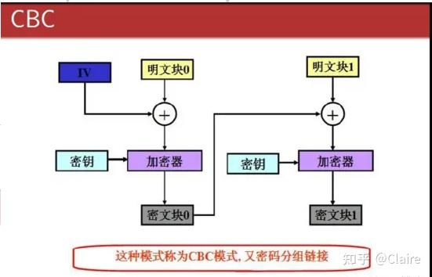

# AES 加解密：常规流程与 WH 项目实际使用

> 整理日期：2026-10-19。源码范围：`D:\workspace\wh` 下的 `wt`、`tp`、`manager`、`glc`。
> 本文结合本地源码和 Maven 缓存中的 `com.wotransfer:core:3.0.1-SNAPSHOT` JAR，重点说明 `manager-data` 如何选用现有方法。示例不包含真实业务密钥。


## 0. 我的理解
### 1. AES、CBC和IV
CBC是AES加密的一种模式

### 2. 为什么IV要随机（虽然项目中使用了固定值）
假如密钥和 IV 都固定，那么相同的第一块明文就会得到相同的第一块密文；两条消息开头有多块相同，密文开头也会对应相同。观察者虽然不一定知道内容，却能看出它们有相同的开头。换一个合适的 IV，就能避免这种规律。

### 3. BC是什么？
见同目录下的”Bouncy Castle“

### 4. 常规加解密流程
见文章“3.3 Java 的常规 CBC 示例”


## 1. 

### 2.1 AES 是对称分组加密

AES 使用同一把秘密密钥进行加密和解密。AES 的分组长度固定为 **128 位，即 16 字节**；密钥则可以是 128、192、256 位，分别对应 16、24、32 字节。

因此，AES-256 表示密钥是 256 位，分组长度仍然是 16 字节。来源：[NIST FIPS 197](https://csrc.nist.gov/pubs/fips/197/final)。

### 2.2 几个容易混淆的概念

| 概念 | 作用 | 在项目中需要注意的地方 |
| --- | --- | --- |
| 明文 | 加密前的数据，例如手机号、JSON 文本 | 文本必须先按约定字符集转换为字节 |
| AES 密钥 | 决定如何加解密的秘密字节 | 方法参数叫 `key`，不代表该字符串字节一定直接作为实际密钥 |
| IV | 初始化向量，参与 CBC 等模式的运算 | CBC 的 IV 必须为 16 字节；应与密文关联保存或按协议传递，不需要当作秘密密钥保存 |
| nonce | 通常表示一次使用的数值 | 项目把一些参数命名为 nonce，但有的直接当 IV，有的还要补字节，不能只看名字 |
| Padding | 让 CBC 等模式的输入满足分组长度要求 | 与 AES 密钥长度是两回事；加解密双方必须一致 |
| Base64 | 将任意字节编码成可传输的文本 | 不是加密；解码 Base64 只能得到密文字节，不会恢复业务明文 |
| 脱敏 | 将展示值变成 `138****0000` 等形式 | 与 AES 加密不同，通常不能仅靠脱敏结果恢复原文 |
| MD5 / SHA-256 | 计算摘要 | 不是可解密的密文，低熵手机号、证件号的普通摘要也可能被枚举 |
| HMAC | 使用秘密密钥计算消息认证码 | 可用于完整性验证或检索摘要，具体取决于协议如何设计 |


### 2.3 `AES/CBC/PKCS5Padding` 这三个部分是什么意思


```text
AES / CBC / PKCS5Padding
 │     │         └─ 填充方式
 │     └─────────── 工作模式
 └───────────────── 分组加密算法
```

项目常见的是 CBC：第一组明文与 IV 异或后加密，后续明文组与上一组密文异或后加密。因此，实际密钥、IV、明文字节、模式和填充方式全部一致时，输出也一致。

AES-CBC 在 Java 中使用 `PKCS5Padding` 时，按 AES 的 16 字节分组进行填充；常见前端库使用名称 `Pkcs7`。对接时应使用已知输入核对结果，不能仅凭填充名称相似就认定兼容。补齐的字节数为 N，每个补齐字节的值为 N；即使原文已经是 16 字节的整数倍，也会再补一整组。

CBC 自身不提供消息认证。常规 CBC 加密应生成不可预测的 IV，而不是每次固定同一个 IV。项目中固定 nonce/IV 的历史方案应按兼容要求理解，不能当作新系统的通用设计。

来源：[NIST SP 800-38A](https://csrc.nist.gov/pubs/sp/800/38/a/final)、[Oracle JCA 指南](https://docs.oracle.com/en/java/javase/17/security/java-cryptography-architecture-jca-reference-guide.html)。

## 3. 常规的 AES 加解密流程

### 3.1 加密流程，以 CBC 为例

```text
业务对象
   │ JSON 序列化（如果本身就是字符串，则无需这一步）
   ▼
明文字符串 ── UTF-8 编码 ──► 明文字节
                                  │
                         实际 AES 密钥 + 16 字节 IV
                                  │
                         AES/CBC/PKCS5Padding
                                  │
                                  ▼
                              密文字节
                                  │
                    按协议组合版本、IV、密文等信息
                                  │
                              Base64 编码
                                  ▼
                       可存入数据库或放入 JSON 的文本
```

步骤：

1. 明确算法、模式、填充方式、字符集和传输格式。
2. 准备实际 AES 密钥。可以使用 `KeyGenerator` 安全生成；如果输入是用户口令，应使用合适的口令派生算法，不能把普通字符串或 MD5 结果等同于安全随机密钥。
3. 为本次 CBC 加密生成不可预测的 16 字节 IV。
4. 创建 `Cipher`，使用 `ENCRYPT_MODE`、实际密钥和 IV 初始化。
5. 调用 `doFinal`，由密码库完成填充和加密。
6. 按约定保存或传输 IV 与密文。密钥应通过独立的密钥管理机制提供，不和密文一起明文存放。

如果使用 CBC 并需要防篡改，还需要正确的认证设计，例如 Encrypt-then-MAC；独立的新方案优先考虑 GCM。来源：[OWASP Cryptographic Storage](https://cheatsheetseries.owasp.org/cheatsheets/Cryptographic_Storage_Cheat_Sheet.html)。

### 3.2 解密流程

```text
接收到的文本
   │ Base64 解码 + 按协议拆包
   ▼
IV 和密文字节
   │ 使用同一把实际 AES 密钥、同样的模式和填充方式
   ▼
Cipher.init(DECRYPT_MODE, key, iv)
   │ doFinal：解密并去掉填充
   ▼
明文字节 ── UTF-8 解码 ──► 明文字符串 ── 可选 JSON 解析 ──► 业务对象
```

如果协议有认证信息，必须按协议验证并在验证失败时终止处理。CBC 的填充错误不等于完整的防篡改校验：错误密钥、错误 IV、传输损坏和参数不匹配都可能造成解密失败。

### 3.3 Java 的常规 CBC 示例

下面用 JDK 标准 API 演示流程，格式约定为 `Base64(16 字节 IV || 密文字节)`。该教学示例没有加入 MAC，独立新业务可使用第 8 节的 GCM 设计。

**这里的整体输出格式与项目工具类仅返回 `Base64(密文)` 的格式不同，不能把整个输出直接交给项目的 `AES2Util.decrypt`。**

```java
import java.nio.charset.StandardCharsets;
import java.security.GeneralSecurityException;
import java.security.SecureRandom;
import java.util.Arrays;
import java.util.Base64;
import javax.crypto.Cipher;
import javax.crypto.KeyGenerator;
import javax.crypto.SecretKey;
import javax.crypto.spec.IvParameterSpec;

public final class StandardAesCbcExample {
    private static final SecureRandom RANDOM = new SecureRandom();

    public static String encrypt(String plainText, SecretKey key)
            throws GeneralSecurityException {
        // 每次生成新的 IV，并随密文保存；密钥由调用方单独管理。
        byte[] iv = new byte[16];
        RANDOM.nextBytes(iv);

        Cipher cipher = Cipher.getInstance("AES/CBC/PKCS5Padding");
        cipher.init(Cipher.ENCRYPT_MODE, key, new IvParameterSpec(iv));
        byte[] ciphertext = cipher.doFinal(plainText.getBytes(StandardCharsets.UTF_8));

        byte[] packed = Arrays.copyOf(iv, iv.length + ciphertext.length);
        System.arraycopy(ciphertext, 0, packed, iv.length, ciphertext.length);
        return Base64.getEncoder().encodeToString(packed);
    }

    public static String decrypt(String encoded, SecretKey key)
            throws GeneralSecurityException {
        byte[] packed = Base64.getDecoder().decode(encoded);
        // IV 为 16 字节，PKCS 填充后的密文至少一组，且必须按组对齐。
        if (packed.length < 32 || (packed.length - 16) % 16 != 0) {
            throw new IllegalArgumentException("密文长度不合法");
        }
        byte[] iv = Arrays.copyOfRange(packed, 0, 16);
        byte[] ciphertext = Arrays.copyOfRange(packed, 16, packed.length);

        Cipher cipher = Cipher.getInstance("AES/CBC/PKCS5Padding");
        cipher.init(Cipher.DECRYPT_MODE, key, new IvParameterSpec(iv));
        return new String(cipher.doFinal(ciphertext), StandardCharsets.UTF_8);
    }

    public static void main(String[] args) throws GeneralSecurityException {
        // 仅为演示生成密钥；真实应用应按生命周期管理并安全持久化密钥。
        KeyGenerator generator = KeyGenerator.getInstance("AES");
        generator.init(128, RANDOM);
        SecretKey key = generator.generateKey();

        String source = "AES 流程示例";
        String encrypted = encrypt(source, key);
        String restored = decrypt(encrypted, key);
        if (!source.equals(restored)) {
            throw new IllegalStateException("加解密往返校验失败");
        }
        System.out.println("CBC round trip passed");
    }
}
```

`Cipher.getInstance`、`init`、`doFinal` 分别负责选择变换、初始化、完成加解密。`Cipher` 对象不能作为共享的可变实例供并发请求无保护地复用；这里每次调用都创建实例。

来源：[Oracle Cipher API](https://docs.oracle.com/en/java/javase/17/docs/api/java.base/javax/crypto/Cipher.html)。

## 4. 项目方法逐个梳理

### 4.1 `AesUtil.aesEncrypt/aesDecrypt`：现有业务字段主流程

核心逻辑可概括为：

```java
// 这是现有兼容算法：key 参数作为随机数算法的种子，而非直接作为 AES 密钥。
KeyGenerator generator = KeyGenerator.getInstance("AES");
SecureRandom random = SecureRandom.getInstance("SHA1PRNG");
random.setSeed(key.getBytes());
generator.init(128, random);
SecretKey actualKey = generator.generateKey();

// IV = nonce 的字节 + 固定的 8 字节后缀。
// 后缀为：00 00 00 00 00 00 00 01。
```

其后执行 `AES/CBC/PKCS5Padding`，输出 `Base64(密文)`。解密时按相同规则重新生成实际密钥和 IV，再 Base64 解码、解密。

注意：

- `generator.init(128, random)` 决定实际密钥是 128 位。即使 key 参数有 24 或 32 个字符，也不会因此变成 AES-192 或 AES-256。
- `getIV` 追加 8 个字节，所以 nonce 必须正好占 8 字节，最终 IV 才是 CBC 要求的 16 字节。
- 输入 key 在这里作为种子，不受“直接 AES 密钥必须是 16/24/32 字节”的同一限制。
- 多处 `getBytes()` 和 `new String(byte[])` 使用默认字符集。这不是可移植的标准密钥派生协议；跨语言、跨 Provider 或升级运行环境时应核对已知密文样例。
- 不应为了“优化”现有方法，把 `SHA1PRNG` 替换成每次全新随机生成的密钥，否则历史密文将无法按原方式解密。

源码：[wt-core AesUtil](D:/workspace/wh/wt/wt-core/src/main/java/com/wotransfer/core/secure/AesUtil.java:54)。

### 4.2 `AesUtil.encrypt/decrypt`：同样生成密钥，但直接使用完整 IV

它与 `aesEncrypt/aesDecrypt` 的实际密钥生成方式相同，区别是：

```text
aesEncrypt / aesDecrypt：IV = nonce 的 8 字节 + 固定 8 字节后缀
encrypt / decrypt：      IV = 传入字符串的完整字节，须为 16 字节
```

如果将第一组方法补齐后的 IV 原样传给第二组方法，且其余条件一致，两组方法可得到一致密文；但把同一个 8 字节 nonce 原样传给 `encrypt/decrypt` 会不满足 IV 长度要求。

项目实际用途之一是启动时解开加密保存的 DEK，见第 6.5 节。

源码：[encrypt](D:/workspace/wh/wt/wt-core/src/main/java/com/wotransfer/core/secure/AesUtil.java:84)、[decrypt](D:/workspace/wh/wt/wt-core/src/main/java/com/wotransfer/core/secure/AesUtil.java:171)。

### 4.3 `AesUtil.simpleEncrypt/simpleDecrypt`：直接使用 key 字节

核心是：

```java
SecretKeySpec keySpec = new SecretKeySpec(key.getBytes(), "AES");
Cipher cipher = Cipher.getInstance("AES/CBC/PKCS5Padding");
cipher.init(Cipher.ENCRYPT_MODE, keySpec, new IvParameterSpec(nonce.getBytes()));
```

- 实际密钥是 key 字符串的字节，必须为 16、24 或 32 字节。
- IV 直接取 nonce 的字节，必须为 16 字节。
- 文本、key、IV 多处使用默认字符集。
- 源码注释“不使用安全算法”指的是没有走前面的 SHA1PRNG 生成密钥步骤，并不是没有使用 AES 加密，也不能据此比较安全性高低。

源码：[simpleEncrypt](D:/workspace/wh/wt/wt-core/src/main/java/com/wotransfer/core/secure/AesUtil.java:109)。

### 4.4 `AES2Util.encrypt/decrypt`：面向前端互通的直接密钥 CBC

核心流程：

```java
Cipher cipher = Cipher.getInstance("AES/CBC/PKCS5Padding", "BC");
SecretKeySpec keySpec = new SecretKeySpec(key.getBytes("UTF-8"), "AES");
IvParameterSpec ivSpec = new IvParameterSpec(nonce.getBytes());
cipher.init(Cipher.ENCRYPT_MODE, keySpec, ivSpec);
byte[] encrypted = cipher.doFinal(content.getBytes("UTF-8"));
```

| 项目 | 行为 |
| --- | --- |
| Provider | 显式指定 Bouncy Castle，即 `BC` |
| 实际密钥 | key 的 UTF-8 字节，必须为 16/24/32 字节 |
| 明文编码 | UTF-8 |
| IV | nonce 的字节，必须为 16 字节；这里仍使用默认字符集 |
| 密文格式 | Base64 编码的密文字节，不自动包含 IV |
| 异常 | 使用 `Throwables.propagate` 转为或继续抛出运行时异常，并非正常返回空串 |

UTF-8 环境下，相同原始 key、相同 IV、相同明文的 `simpleEncrypt` 与 `AES2Util.encrypt` 可得到相同密文。跨语言对接仍须核对原始字节；例如，32 个十六进制字符可能代表“32 字节文本”，也可能需要先解码成“16 字节密钥”，两者不同。

源码：[wt-core AES2Util](D:/workspace/wh/wt/wt-core/src/main/java/com/wotransfer/core/secure/AES2Util.java:36)、[tp-core AES2Util](D:/workspace/wh/tp/tp-core/src/main/java/com/tp/core/secure/AES2Util.java:36)。

### 4.5 `encryptWithNoPadding/decryptWithNoPadding`

这组方法使用原始 key 字节、完整 16 字节 IV 和 `AES/CBC/NoPadding`。

明文字节长度必须是 16 的整数倍。它不会自动补齐；中文应按编码后的字节长度计算。该方法不是让任意业务字符串“少一次填充操作”的通用替代，只适合明确规定该格式的协议。

源码：[encryptWithNoPadding](D:/workspace/wh/wt/wt-core/src/main/java/com/wotransfer/core/secure/AesUtil.java:126)。

### 4.6 `encryptWithBC/decryptWithBC`：历史密码字段格式

这组方法使用 Bouncy Castle 的底层 API：

```text
key 字符串字节
   │ 放入长度为 32 的零初始化缓冲区
   ▼
32 字节实际密钥：不足补零，超出则缓冲区溢出
   │
AES + CBC + PKCS7Padding；初始化时只传 KeyParameter，没有显式传 IV
   ▼
Base64(密文)
```

当前 BC 实现的该初始化路径使用全零 IV。它与 `aesEncrypt` 的种子密钥、8 字节 nonce 补齐规则不同，也与 `AES2Util` 的原始 key、调用方传 IV 规则不同。

`manager-data` 的重置密码分支会使用它；`glc` 的 `encryptPassword/decryptPassword` 也调用这组方法。这是在说明已有可逆密码密文格式，不是新密码存储方案的建议。新密码存储应采用专门的单向密码哈希方案。

源码：[wt-core encryptWithBC](D:/workspace/wh/wt/wt-core/src/main/java/com/wotransfer/core/secure/AesUtil.java:248)、[manager UsersController](D:/workspace/wh/manager/manager-data/src/main/java/com/wotransfer/dataManagement/controller/UsersController.java:463)、[glc 密码方法](D:/workspace/wh/glc/glc-core/src/main/java/com/wotransfer/glc/core/utils/CryptoComponent.java:96)。

### 4.7 网关 `AESUtil.encrypt/decrypt`

网关版本的流程是：

```text
password
   │ MD5，转成 32 个大写十六进制字符
   ▼
这 32 个字符的字节作为 AES 密钥
   │ 固定 16 字节 IV
   ▼
AES/CBC/PKCS5Padding
   │
Base64(密文)
```

这里取的是 MD5 的十六进制文本字节，不是 MD5 的 16 字节原始摘要。虽然形成了 32 字节 AES 密钥，但 MD5 的输出和输入口令熵限制不会因此消失，不能等同于安全随机生成的 256 位密钥。

这组方法捕获多种异常、打印堆栈后返回 null；固定 IV 和特定 password 变换更像已有对接协议的约定。`manager-data` 新功能没有理由优先选这一版。

源码：[网关 AESUtil](D:/workspace/wh/wt/wt-gateway/src/main/java/com/wotransfer/gateway/utils/AESUtil.java:20)、[MD5Util.md5_](D:/workspace/wh/wt/wt-gateway/src/main/java/com/wotransfer/gateway/utils/MD5Util.java:11)。

### 4.8 汇总：方法名不能代替协议

| 方法 | 实际密钥 | IV | 模式 / 填充 |
| --- | --- | --- | --- |
| `AesUtil.aesEncrypt/aesDecrypt` | key 作 SHA1PRNG 种子，生成 128 位密钥 | 8 字节 nonce + 固定后缀 | CBC / PKCS5Padding |
| `AesUtil.encrypt/decrypt` | 同上 | 直接使用 16 字节 IV | CBC / PKCS5Padding |
| `AesUtil.simpleEncrypt/simpleDecrypt` | key 的默认字符集字节 | 直接使用 16 字节 IV | CBC / PKCS5Padding |
| `AES2Util.encrypt/decrypt` | key 的 UTF-8 字节 | 直接使用 16 字节 IV | CBC / PKCS5Padding，BC Provider |
| `AesUtil.encryptWithNoPadding/decryptWithNoPadding` | key 的默认字符集字节 | 直接使用 16 字节 IV | CBC / NoPadding |
| `AesUtil.encryptWithBC/decryptWithBC` | key 字节放入 32 字节缓冲区，不足补零 | 当前实现初始全零 IV | CBC / PKCS7Padding，BC 底层 API |
| 网关 `AESUtil.encrypt/decrypt` | MD5 大写十六进制文本的字节 | 类内固定 IV | CBC / PKCS5Padding |

## 5. 不同项目的副本有什么区别

| 位置 | 与其他版本的关系 | 差异 |
| --- | --- | --- |
| `wt/wt-core` 的 `AesUtil` | manager 使用的同包名工具这一系 | 方法较多；`aesDecrypt` 内部捕获异常，记录日志后返回空串 |
| `tp/tp-core` 的 `AesUtil` | 主加解密流程与 wt 版本相近 | 包名为 `com.tp`；`aesDecrypt` 直接抛异常；没有 NoPadding 方法 |
| `tp/wt-ocr` 的 `AesUtil` | 与 wt-core 高度相近 | 同为 `com.wotransfer.core.secure` 包名；主流程及空串失败行为相近 |
| `wt/wt-compliance-data` 的 `AesUtil` | 合规项目内的相近副本 | 使用合规项目包名和 BaseConst；`aesDecrypt` 直接抛异常；缺少 simple、NoPadding 方法 |
| wt-core、tp-core 的 `AES2Util` | 两份本地源码的加解密逻辑相同 | 主要是包名和 BaseConst 引用不同 |
| `glc` | 没有另一个同名独立实现 | `CryptoComponent` 引用 `com.wotransfer.core.secure` 中的类 |

来源：[tp AesUtil](D:/workspace/wh/tp/tp-core/src/main/java/com/tp/core/secure/AesUtil.java:126)、[wt-ocr AesUtil](D:/workspace/wh/tp/wt-ocr/src/main/java/com/wotransfer/core/secure/AesUtil.java:148)、[合规 AesUtil](D:/workspace/wh/wt/wt-compliance-data/compliancedata-biz/src/main/java/com/wotransfer/compliancedata/utils/AesUtil.java:108)。

## 6. manager-data 的实际使用

### 6.1 入库：密文、摘要、脱敏展示值分别保存

以 `SchoolAgentConvert.processEncryption` 处理手机号为例：

```text
原始手机号
   ├─ AesUtil.aesEncryptWithoutAsterrisk ─► phoneNumberMask：可解密密文
   ├─ MD5Util.encode                    ─► phoneNumberMd5：摘要
   └─ CommonUtils.hideString            ─► phoneNumber：脱敏展示值
```

这个项目中的 `phoneNumberMask` 名称容易误导：在该流程中，它存的是 **AES 密文**；带星号的展示内容反而保存在 `phoneNumber` 中。

该方法在输入非空且不含 `*` 时处理，以免把页面回传的脱敏文本重新加密。证件号有相同的处理方式。另一处邮箱入库流程会先转小写再加密、计算摘要，说明大小写、空格、手机号格式等归一化步骤也属于数据兼容约定。

来源：[SchoolAgentConvert.processEncryption](D:/workspace/wh/manager/manager-data/src/main/java/com/wotransfer/dataManagement/convert/SchoolAgentConvert.java:130)、[邮箱转小写的例子](D:/workspace/wh/manager/manager-data/src/main/java/com/wotransfer/dataManagement/factory/wallet/kyc/EuWalletKycBuilder.java:559)。

### 6.2 查询：先把输入加密，再按密文字段匹配

`WalletUserServiceImpl.selectCustomers` 会先把输入的手机号和邮箱转换成密文查询条件：

```java
// 摘录为简化的流程示例；aesKey 来自 common.wallet 配置。
params.setPhoneNumberMask(AesUtil.aesEncrypt(
        params.getPhoneNumber(),
        commonWalletConfigs.getAesKey(),
        BaseConst.AES_NONCE));
params.setPhoneNumber(null);

// 后续 example.and().andEqualTo(params)，按密文字段匹配数据库记录。
```

这能匹配的前提是，查询和入库使用相同实际密钥、固定 nonce、编码及归一化规则，相同输入得到相同密文。

这是当前业务依赖确定性密文的一个例子，也说明不能直接把该字段改成每次随机 IV 的加密方式。新方案如使用随机 IV/GCM，需要另外设计检索字段，例如使用独立检索密钥的 HMAC，并安排历史数据迁移；确定性密文会泄漏“哪些记录的值相同”。

来源：[WalletUserServiceImpl.selectCustomers](D:/workspace/wh/manager/manager-data/src/main/java/com/wotransfer/dataManagement/service/impl/WalletUserServiceImpl.java:42)、[CommonWalletConfigs](D:/workspace/wh/manager/manager-data/src/main/java/com/wotransfer/dataManagement/config/CommonWalletConfigs.java:7)。

### 6.3 解密：密文字段还原成业务值

`SchoolAgentConvert.convertDTOByDO` 使用：

```java
String phoneNumber = AesUtil.aesDecrypt(
        payerInfo.getPhoneNumberMask(),
        aesKey,
        BaseConst.AES_NONCE);
```

解密后的明文用于构造业务 DTO。AES 解密能力本身不等于业务访问权限；是否允许展示完整手机号，仍由调用业务决定。

普通现有字段的调用模板：

```java
import com.wotransfer.core.constants.BaseConst;
import com.wotransfer.core.secure.AesUtil;

// 以下语句放在允许抛出 Exception 的业务方法中。
String ciphertext = AesUtil.aesEncrypt(plainText, aesKey, BaseConst.AES_NONCE);
String restored = AesUtil.aesDecrypt(ciphertext, aesKey, BaseConst.AES_NONCE);
```

来源：[SchoolAgentConvert.convertDTOByDO](D:/workspace/wh/manager/manager-data/src/main/java/com/wotransfer/dataManagement/convert/SchoolAgentConvert.java:49)。

### 6.4 `CryptService.en/de` 也是同一套字段算法的包装

实际调用链：

```text
CryptServiceImpl.en(body)
   └─ new SensitiveEncryptPojo(body, aesKey)
        └─ AesUtil.aesEncrypt(body, aesKey, BaseConst.AES_NONCE)

CryptServiceImpl.de(ciphertext)
   └─ SensitiveEncryptPojo.decrypt(ciphertext, aesKey)
        └─ AesUtil.aesDecrypt(ciphertext, aesKey, BaseConst.AES_NONCE)
```

`CryptServiceImpl.aes(body)` 也调用相同的 `AesUtil.aesEncrypt`。因此 `en` 和 `aes` 不是两套不同 AES 协议；`en` 的包装类还会计算脱敏展示值、MD5 等信息，`encryptPhone/encryptEmail/encryptID` 等入口也复用该包装。

但“底层算法相同”不代表“所有调用的实际密钥相同”：`CryptServiceImpl` 的密钥来自 `aes.encrypt.key` 或启动解包后的 DEK，而钱包部分调用来自 `common.wallet.aesKey` 对应的配置绑定。是否为同一密钥，需要按环境配置核对。

`EuWalletKycBuilder` 有一个具体例子：先用 `commonWalletConfigs.getAesKey()` 解开已有证件号，再用 `cryptService.en(idNumber)` 生成另一个查询所需的密文。源码能确认它重新处理了明文，不能仅凭这段调用断言两个配置值相同或不同。

来源：[CryptServiceImpl.en/de](D:/workspace/wh/manager/manager-data/src/main/java/com/wotransfer/dataManagement/service/impl/CryptServiceImpl.java:71)、[SensitiveEncryptPojo 构造函数](D:/workspace/wh/manager/manager-data/src/main/java/com/wotransfer/dataManagement/pojo/SensitiveEncryptPojo.java:35)、[SensitiveEncryptPojo.decrypt](D:/workspace/wh/manager/manager-data/src/main/java/com/wotransfer/dataManagement/pojo/SensitiveEncryptPojo.java:122)、[跨入口查询例子](D:/workspace/wh/manager/manager-data/src/main/java/com/wotransfer/dataManagement/factory/wallet/kyc/EuWalletKycBuilder.java:387)。

### 6.5 启动时解开 DEK：`AesUtil.decrypt` 的另一种使用层次

`CryptServiceImpl.init` 的流程：

```text
配置 aes.encrypt.key ────────────────────────────► 初始 aesKey

若 KEK 文件存在，且配置 aes.encrypt.dek 非字符串 "null"
   │
   ├─ 读取 aes.encrypt.kek.path 指向的文件，得到 KEK
   ├─ AesUtil.decrypt(加密的 DEK 配置值, KEK, 约定的完整 IV)
   └─ 将解出的业务 key 字符串赋给 aesKey
         │
         └─ 后续 en/de、aes、encryptPhone 等业务字段方法使用该值
```

概念上，KEK 是保护数据密钥的密钥，DEK 是业务数据密钥。这里配置中的 `DEK` 字符串实际保存的是被加密的业务 key，而不是可直接拿来加密正文的原始值。

还要分清两层：解开 DEK 时调用的是完整 IV 版本的 `AesUtil.decrypt`；业务字段加密时调用 `aesEncrypt`，又按种子规则生成实际 AES 密钥。不能把这两层参数直接混为一谈。

来源：[CryptServiceImpl.init](D:/workspace/wh/manager/manager-data/src/main/java/com/wotransfer/dataManagement/service/impl/CryptServiceImpl.java:21)。

### 6.6 其他已确认的使用点

| 场景 | 调用 | 说明 |
| --- | --- | --- |
| 数据源配置中的用户名、密码解密 | `AesUtil.aesDecrypt` | 使用 `BaseConst.DB_AES_KEY/DB_AES_NONCE`，不是所有地方都使用业务字段 key |
| 用户重置密码的部分分支 | `AesUtil.encryptWithBC` | 属于历史密码密文格式 |
| `RSAAndAESEncryptionUtil` 工具类 | `Cipher.getInstance("AES")` | 未显式指定模式和填充，由 Provider 采用默认值；常见 SunJCE 默认为 ECB/PKCS5Padding，不宜作为新的通用标准 |

本次检索 `RSAAndAESEncryptionUtil`，只发现类内 main 演示调用，没有发现其他业务类对它的直接引用；不能仅凭该工具类存在就认为它代表项目主流程。

来源：[DataSourceSettingsRO](D:/workspace/wh/manager/manager-data/src/main/java/com/wotransfer/dataManagement/config/DataSourceSettingsRO.java:62)、[UsersController](D:/workspace/wh/manager/manager-data/src/main/java/com/wotransfer/dataManagement/controller/UsersController.java:463)、[RSAAndAESEncryptionUtil](D:/workspace/wh/manager/manager-data/src/main/java/com/wotransfer/dataManagement/utils/RSAAndAESEncryptionUtil.java:28)、[Oracle Provider 默认规则](https://docs.oracle.com/en/java/javase/17/security/oracle-providers.html)。

## 7. AES2Util 在 glc 中的实际报文加密

`glc-core` 的 `CryptoComponent.encryptRequest` 展示了 AES 与 RSA、HMAC 组合使用的实际场景：

```text
业务请求对象 ── JSON 序列化 ──► srcData
                                  │
    AlgorithmUtil.getRandomAesKey() 提供本次 aesKey
                                  │
           AES2Util.encrypt(srcData, aesKey, 约定 IV)
                                  ▼
                            AES 正文密文

srcData + 本次 hmacKey ── HMAC-SHA256 ──► sign

RSA 公钥分别加密 hmacKey 和 aesKey
   │
   ▼
RSA(hmacKey) $ RSA(aesKey) $ AES正文密文 $ sign
   │
   ▼
放入 JSON 的 data 字段，并在调用时设置 RS 请求头
```

对应的 `decryptRequest` 会拆开四段，使用 RSA 私钥解出 AES key，再通过 `AES2Util.decrypt` 解正文，随后解出 HMAC key 并重新计算明文的 HMAC，比对成功后再解析业务结果。这里只是在描述现有实现的顺序。

职责分别是：

- AES：加密正文。
- RSA：保护传输中的对称密钥，前提是使用可信的接收方公钥。
- HMAC：按该协议校验消息完整性；这里名为 `sign` 的值是 HMAC，不是非对称数字签名。

该协议有独立 HMAC 校验，因此不能因为 `AES2Util` 本身只有 CBC 就直接认定整个报文完全没有认证；同时，也不能把这套 HMAC 计算在明文上的历史协议等同于常规 Encrypt-then-MAC 设计。

`CryptoComponent` 也有另一组数据库字段方法：`encryptField/decryptField` 继续调用 `AesUtil.aesEncrypt/aesDecrypt`。同一个项目因数据用途不同，同时使用两套参数规则是正常的。

此外，wt-core 源码中的 `SecureCrypt` 是另一种五段 `#` 分隔格式，使用 `AesUtil.aesEncrypt`、8 字节 nonce，并对密文计算 HMAC。它与上面四段 `$` 格式、AES2 正文处理、明文 HMAC 的协议不同，不能混用。

来源：[glc encryptRequest](D:/workspace/wh/glc/glc-core/src/main/java/com/wotransfer/glc/core/utils/CryptoComponent.java:186)、[glc decryptRequest](D:/workspace/wh/glc/glc-core/src/main/java/com/wotransfer/glc/core/utils/CryptoComponent.java:285)、[glc 字段加密](D:/workspace/wh/glc/glc-core/src/main/java/com/wotransfer/glc/core/utils/CryptoComponent.java:118)、[wt-core SecureCrypt](D:/workspace/wh/wt/wt-core/src/main/java/com/wotransfer/core/secure/SecureCrypt.java:34)。

关于 glc HTTP 拦截器、请求体 Advice 和响应体处理的更完整流程，可继续阅读同目录的 [readme.md](C:/Users/erzhuochen/Desktop/笔记/项目/wh/加密解密/readme.md)。

## 8. 新增独立方案：为什么优先考虑 AES-GCM

CBC 与 GCM 的区别不只是参数名不同：GCM 同时提供加密和认证标签。JDK 的典型初始化形式如下，下面是流程片段，不是可直接替换历史工具类的完整协议实现。

```java
byte[] nonce = new byte[12];
secureRandom.nextBytes(nonce);

Cipher cipher = Cipher.getInstance("AES/GCM/NoPadding");
GCMParameterSpec params = new GCMParameterSpec(128, nonce);
cipher.init(Cipher.ENCRYPT_MODE, secretKey, params);
// 如需将版本、业务上下文等作为 AAD，双方必须使用同一组字节。
cipher.updateAAD(aadBytes);
byte[] ciphertextAndTag = cipher.doFinal(plainText.getBytes(StandardCharsets.UTF_8));
```

独立新格式可设计为：

```text
version + keyId + nonce + ciphertext + tag
```

其中 keyId 用于定位密钥版本，不包含秘密密钥本身；各字段边界和编码必须固定。JDK GCM 的 `doFinal` 结果已经包含认证标签，组包时不要重复追加。

同一密钥下 GCM nonce 必须不重复；随机 12 字节是常见生成方式，但仍需结合用量控制碰撞概率。解密时使用相同 key、nonce、AAD，标签校验失败必须终止，不返回未经验证的明文。旧数据兼容、密钥轮换、检索字段和迁移策略需要同时安排。

来源：[NIST SP 800-38D](https://csrc.nist.gov/pubs/sp/800/38/d/final)、[Oracle Cipher 的 AEAD 说明](https://docs.oracle.com/en/java/javase/17/docs/api/java.base/javax/crypto/Cipher.html)、[OWASP 算法选择建议](https://cheatsheetseries.owasp.org/cheatsheets/Cryptographic_Storage_Cheat_Sheet.html)。

## 9. 现有代码的失败行为与常见排查点

### 9.1 不要把返回值直接等同于加解密成功

| 方法或入口 | 已观察到的行为 | 使用时的含义 |
| --- | --- | --- |
| wt-core / wt-ocr 的 `aesDecrypt` | 捕获异常后返回空串 | 即使方法声明 throws，外层 catch 也不一定能收到解密失败 |
| tp-core / 合规项目的 `aesDecrypt` | 失败向外抛异常 | 替换副本会改变调用方看到的失败行为 |
| `aesEncryptWithoutAsterrisk` | 含星号时返回输入；异常时也返回输入 | 不能把“返回非空字符串”视为已经加密，失败时可能返回原始明文 |
| `AES2Util.encrypt/decrypt` | `Throwables.propagate` 抛运行时异常 | 不是失败后正常返回空串 |
| 网关 `AESUtil` | 捕获多种异常后返回 null | 调用方必须识别失败 |
| `SensitiveEncryptPojo` | 加密异常会写空串，但相关 catch 未同步修改 errorCode | `isSuc()` 仅判断 errorCode 是否为 0，不能单独证明 AES 加密成功 |

`randomKey` 使用 `Math.random()`，wt-core `SecureCrypt` 的旧随机 key 实现使用 `java.util.Random`；这些现有实现不应直接作为新密钥生成的示范。新密钥和随机 IV 使用密码学安全随机源。

来源：[aesEncryptWithoutAsterrisk](D:/workspace/wh/wt/wt-core/src/main/java/com/wotransfer/core/secure/AesUtil.java:135)、[SensitiveEncryptPojo 加密异常处理](D:/workspace/wh/manager/manager-data/src/main/java/com/wotransfer/dataManagement/pojo/SensitiveEncryptPojo.java:40)、[isSuc](D:/workspace/wh/manager/manager-data/src/main/java/com/wotransfer/dataManagement/pojo/SensitiveEncryptPojo.java:136)、[SecureCrypt 随机 key](D:/workspace/wh/wt/wt-core/src/main/java/com/wotransfer/core/secure/SecureCrypt.java:22)。

### 9.2 解密失败时按字节核对

| 现象 | 优先核对 |
| --- | --- |
| `Invalid AES key length` | 是否直接密钥方法；UTF-8 后是否为 16/24/32 字节；是否把 Base64/Hex 文本误当成原始密钥 |
| IV 长度错误 | 该方法要 8 字节 nonce，还是完整 16 字节 IV；是否重复补齐 |
| `BadPaddingException` | 密钥、IV、模式、填充、Base64、密文完整性；不能据此唯一断定是哪项错误 |
| CBC/NoPadding 长度错误 | 明文字节数或密文字节数是否按 16 字节对齐 |
| 中文乱码或跨服务结果不同 | 默认字符集与 UTF-8 差异，JSON 序列化、大小写、空格等输入差异 |
| 同一明文的密文不同 | 是否使用随机 IV；是否选了种子密钥与直接密钥两种不同方法；实际 key 配置是否一致 |
| 密文查询无结果 | 入库与查询的 key、nonce、方法、归一化规则是否一致；是否发生密钥版本变化 |
| `NoSuchProviderException: BC` | Bouncy Castle 是否在依赖中且已注册，运行环境与缓存 JAR 是否一致 |
| `NoClassDefFoundError` | 缺少的依赖是否为 BC、Hutool、Guava 等；不能只拷贝一个类或一个 core JAR 就假定依赖完整 |

## 10. 版本与验证记录

### 10.1 源码版本与项目依赖并不相同

- 本地 `wt/wt-core/pom.xml` 声明的是 `2.0.5-SNAPSHOT`。
- `manager-data/pom.xml` 声明依赖 `core:3.0.1-SNAPSHOT`。
- 本次同时检查了本地 Maven 缓存的 `core-3.0.1-SNAPSHOT.jar`。其中 AesUtil 的主要密钥/IV 处理与上文一致；AES2Util 的 encrypt 相比本地旧源码还增加了 Provider/Hutool 相关处理，包括 `SecureUtil.disableBouncyCastle()` 调用。
- 这说明“同名源码”不等于“实际依赖 JAR 完全相同”。SNAPSHOT 也可能更新，部署环境应以最终解析的依赖版本与内容为准。

来源：[wt-core POM](D:/workspace/wh/wt/wt-core/pom.xml:10)、[manager-data POM](D:/workspace/wh/manager/manager-data/pom.xml:153)。

本地验证 JAR：[core-3.0.1-SNAPSHOT.jar](C:/Users/erzhuochen/.m2/repository/com/wotransfer/core/3.0.1-SNAPSHOT/core-3.0.1-SNAPSHOT.jar)。缓存对应的带时间戳版本为 `core-3.0.1-20261008.012801-315.jar`。

### 10.2 已执行的兼容性验证

在本机环境中，使用 Maven 缓存的 core JAR 和所需依赖，以测试用 key、含中文明文验证：

1. `AesUtil.aesEncrypt` → `aesDecrypt` 可以还原原文。
2. `AES2Util.encrypt` → `decrypt` 可以还原原文。
3. 传入相同 key 文本、相同有效 IV 时，`aesEncrypt` 与 `AES2Util.encrypt` 的结果不同，因为前者实际使用种子生成的密钥。
4. 将 8 字节 nonce 按旧规则补成完整 IV 后，`aesEncrypt` 与 `AesUtil.encrypt` 得到相同结果。
5. 本机 UTF-8 环境下，`AesUtil.simpleEncrypt` 与 `AES2Util.encrypt` 得到相同结果。
6. `encryptWithBC` 的密文与“32 字节补零密钥 + 全零 IV + 标准 AES-CBC/PKCS 填充”的结果一致，且 `decryptWithBC` 可以还原含中文原文。
7. 第 3.3 节的完整 Java 示例已从本文提取，使用 `javac --release 17` 编译并运行，加解密往返检查通过。

这些验证说明本机参数规则和互通关系，不代表已覆盖所有 Provider、部署环境或业务字段。本次整理不修改项目算法和历史密文。
