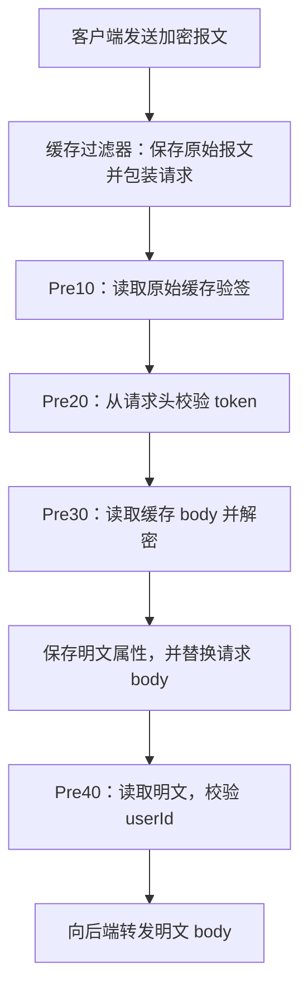

# 缓存请求体

> 项目：`wt-web-gateway`。本文根据当前项目代码整理，重点说明请求体为什么需要缓存，以及后续过滤器如何读取原始报文和解密明文。

## 1. 为什么需要缓存请求体

WebFlux 的原始请求体是来自网络连接的数据流，通常只能消费一次。如果一个过滤器先读取了它，后续过滤器或转发逻辑再次读取时，可能读不到内容，或者出现重复订阅错误。

例如，网关需要先读取请求体做校验，再把同一份内容转发给后端：

```text
未缓存：
原始请求体 → 第一个过滤器读取 → 原始流被消费 → 后续读取可能失败

已缓存：
原始请求体 → 读取并缓存
                  ├─ 验签过滤器读取缓存
                  └─ 包装请求通过 getBody() 提供缓存内容
```

缓存相当于先把一次性的输入记下来，让后面的处理步骤可以使用同一份内容。缓存必须在其他过滤器消费原始请求体之前完成。

本文涉及的请求体属性保存在本次请求的 `exchange` 中，不是 Redis 缓存，也不会供其他请求共享。

## 2. 缓存过滤器如何工作

源码：[PreCacheBodyGlobalPreFilter.java](/D:/workspace/wh/wt/wt-web-gateway/src/main/java/com/wotransfer/webgateway/filters/PreCacheBodyGlobalPreFilter.java:23)。

将项目中的代码展开后：

```java
@Override
public Mono<Void> filter(ServerWebExchange exchange, GatewayFilterChain chain) {
    log.debug("请求路径{}-{}",
        exchange.getRequest().getPath(),
        exchange.getRequest().getMethod().name());

    return ServerWebExchangeUtils.cacheRequestBody(exchange, cachedRequest -> {
        ServerWebExchange newExchange = exchange.mutate()
            .request(cachedRequest)
            .build();

        return chain.filter(newExchange);
    });
}

@Override
public int getOrder() {
    return Ordered.HIGHEST_PRECEDENCE;
}
```

### 2.1 参数和返回值

| 名称 | 含义 |
| --- | --- |
| `exchange` | 本次 HTTP 请求的上下文，包含请求、响应和属性 |
| `chain` | 后续过滤器链，调用 `chain.filter(...)` 继续处理请求 |
| `cachedRequest` | 缓存方法传给回调的请求对象；有请求体时，包装请求通过 `getBody()` 提供缓存内容 |
| `Mono<Void>` | 异步处理完成或失败的信号，不返回业务数据；HTTP 响应仍可通过 `exchange` 写出 |

框架负责订阅返回的响应式处理链；这里不需要手动调用 `subscribe()` 或 `block()`。

### 2.2 执行过程

1. `log.debug(...)` 记录请求路径和 HTTP 方法，例如 `请求路径/api/order-POST`。只有启用 DEBUG 日志时才输出，这里没有打印请求体。
2. `cacheRequestBody(...)` 读取、聚合请求体，并将非空请求体缓存为 `DataBuffer`，保存到 `CACHED_REQUEST_BODY_ATTR`。
3. 该方法向回调提供包装请求，让请求的 `getBody()` 能从缓存提供数据。
4. `exchange.mutate().request(cachedRequest).build()` 创建包装后的 `exchange`，替换其中的请求对象。缓存属性仍然可供后续过滤器访问。
5. `chain.filter(newExchange)` 将这个上下文交给后续过滤器。

这一步只缓存并包装请求，没有解密内容，也没有解析 JSON。只保存缓存属性而不向后续传递包装请求，不能保证后续通过 `getBody()` 读到缓存。

`Ordered.HIGHEST_PRECEDENCE` 保证它先于下文列出的业务过滤器执行。

参考：[Spring Cloud Gateway 的 ServerWebExchangeUtils 源码](https://github.com/spring-cloud/spring-cloud-gateway/blob/main/spring-cloud-gateway-server-webflux/src/main/java/org/springframework/cloud/gateway/support/ServerWebExchangeUtils.java)。该链接指向主分支，具体细节应以项目实际依赖版本为准。

## 3. 项目中的缓存和请求 body

需要区分两份属性缓存，以及解密装饰器用于转发的 body：

| 存储位置 | 内容及类型 | 主要用途 |
| --- | --- | --- |
| `exchange[CACHED_REQUEST_BODY_ATTR]` | 原始请求体，类型为 `DataBuffer`；加密请求保存的是原始加密报文 | 验签、读取未加密原文，以及为包装请求提供原始 body |
| `exchange[GatewayConst.DECRYPTED_BODY_ATTR]` | 解密成功后的明文，类型为 `String`；实际属性名是 `DECRYPTED_BODY` | 业务校验直接读取明文 |
| `CachedBodyOutputMessage` | `ModifyRequestBodyDecorator` 写入的处理后 body；不作为上述属性保存 | 为新的请求装饰器提供 body，交给后续处理和转发 |

**替换请求 body，不会自动覆盖 `CACHED_REQUEST_BODY_ATTR`。** 当前项目中，原始缓存用于保留客户端发送的内容；解密明文另存一个属性。

## 4. 后续过滤器如何使用缓存

下面是本文涉及的业务过滤器顺序；其他框架过滤器可能穿插执行。

| 过滤器 | 顺序 | 请求体的使用方式 |
| --- | ---: | --- |
| `PreCacheBodyGlobalPreFilter` | `HIGHEST_PRECEDENCE` | 缓存原始请求体，传递包装请求 |
| `Pre10SignatureGlobalFilter` | 10 | 直接读取原始缓存，用于验签 |
| `Pre20TokenGlobalFilter` | 20 | 从请求头读取 token，不读取请求体 |
| `Pre30DecryptGlobalFilter` | 30 | 通过包装请求读取原始 body，按条件解密并替换 body |
| `Pre40BusinessCheckGlobalFilter` | 40 | 优先读取明文属性，提取 `userId` 做业务校验 |

### 4.1 验签：直接读取原始缓存属性

源码：[Pre10SignatureGlobalFilter.java](/D:/workspace/wh/wt/wt-web-gateway/src/main/java/com/wotransfer/webgateway/filters/Pre10SignatureGlobalFilter.java:141)。

进入验签分支时：

```java
String resBody = Objects.toString(
    GatewayHttpUtil.getBodyContent(exchange), ""
);
```

工具方法源码：[GatewayHttpUtil.java](/D:/workspace/wh/wt/wt-web-gateway/src/main/java/com/wotransfer/webgateway/utils/GatewayHttpUtil.java:31)。

它首先读取缓存属性：

```java
Object attribute = exchange.getAttribute(
    ServerWebExchangeUtils.CACHED_REQUEST_BODY_ATTR
);
```

随后根据缓冲区类型，使用 `asByteBuffer()` 获取字节视图，再按 UTF-8 解码为字符串：

```text
exchange 属性 → 缓存的 DataBuffer → 字节视图 → UTF-8 字符串
```

这条路径没有再次订阅原始网络请求体。验签使用的是 `resBody + timestamp`，即客户端发送的原始报文加时间戳。对于加密请求，验签发生在解密之前。

没有签名的请求会进入单独的无签名处理分支，不执行上述 body 验签。工具方法在缓存为空、类型不支持或请求为 `multipart/form-data` 时返回 `null`；验签调用处将 `null` 转为空字符串。

### 4.2 Token 校验：不读取请求体

源码：[Pre20TokenGlobalFilter.java](/D:/workspace/wh/wt/wt-web-gateway/src/main/java/com/wotransfer/webgateway/filters/Pre20TokenGlobalFilter.java:52)。

该过滤器从请求头中读取 token，并进行登录状态、黑名单、会话等检查。它没有读取 body，因此不会消费请求体缓存提供的数据流。

### 4.3 解密：通过包装请求读取 body，再提供处理后的 body

源码：[Pre30DecryptGlobalFilter.java](/D:/workspace/wh/wt/wt-web-gateway/src/main/java/com/wotransfer/webgateway/filters/Pre30DecryptGlobalFilter.java:74)。

它将处理委托给装饰器：

```java
return new ModifyRequestBodyDecorator(exchange, modifyBody())
    .filter(exchange, chain);
```

装饰器源码：[ModifyRequestBodyDecorator.java](/D:/workspace/wh/wt/wt-web-gateway/src/main/java/com/wotransfer/webgateway/filters/decorator/ModifyRequestBodyDecorator.java:55)。

装饰器创建 `ServerRequest`：

```java
ServerRequest serverRequest = ServerRequest.create(exchange, messageReaders);
```

再通过 `serverRequest.bodyToMono(String.class)` 读取请求体，交给 `rewriteFunction` 处理。由于前面的缓存过滤器已经替换请求对象，这里读取的是包装请求提供的缓存内容。

当前装饰器只处理代码中匹配的 JSON Content-Type；没有 Content-Type 或不匹配时直接放行。进入处理后，如果没有有效的 `RS` 请求头，或者内容不是 JSON，解密逻辑返回原文。

解密及完整性校验成功后，保存明文属性并返回明文：

```java
exchange.getAttributes().put(
    GatewayConst.DECRYPTED_BODY_ATTR, decryptData
);
return decryptData;
```

装饰器将返回内容写入 `CachedBodyOutputMessage`，创建新的请求装饰器，再传给后续过滤器。新请求的 body 来自：

```java
@Override
public Flux<DataBuffer> getBody() {
    return outputMessage.getBody();
}
```

所以，成功解密后，后续转发读取到的是明文；原始缓存属性仍保留加密报文。

### 4.4 业务校验：优先读取明文属性

源码：[Pre40BusinessCheckGlobalFilter.java](/D:/workspace/wh/wt/wt-web-gateway/src/main/java/com/wotransfer/webgateway/filters/Pre40BusinessCheckGlobalFilter.java:164)。

```java
private String readPlaintextBody(ServerWebExchange exchange) {
    Object decrypted = exchange.getAttribute(GatewayConst.DECRYPTED_BODY_ATTR);
    if (decrypted instanceof String && StrUtil.isNotBlank((String) decrypted)) {
        return (String) decrypted;
    }
    return GatewayHttpUtil.getBodyContent(exchange);
}
```

它的读取顺序是：

1. 优先从 URL 查询参数读取 `userId`。
2. 查询参数没有 `userId` 时，再读取 body：优先使用解密明文属性，没有有效明文时回退到原始缓存。
3. 从 body 中提取 `userId`，与 token 中的 `userId` 比较。

这一步直接读取属性，没有再次订阅改写后的请求 body，后续转发仍可读取该 body。

总开关关闭或路径命中排除名单时，整个业务校验直接放行。当两侧 `userId` 都存在且不一致时记录日志；是否拦截还取决于校验开关。

## 5. 一个加密请求的完整例子

假设客户端发送一个携带签名和 `RS` 请求头的 JSON 请求，解密后的内容为：

```json
{"userId":1001,"quantity":2}
```

URL 中没有 `userId` 查询参数，token 中的 `userId` 为 `1001`，相关校验已开启且请求未命中排除路径。



| 阶段 | 原始缓存属性 | 明文属性 | 当前请求 body |
| --- | --- | --- | --- |
| 缓存完成 | 原始加密报文的 `DataBuffer` | 尚未设置 | 通过缓存包装请求提供加密报文 |
| 验签完成 | 原始加密报文 | 尚未设置 | 仍可通过包装请求读取加密报文 |
| 解密完成 | 仍是原始加密报文 | `{"userId":1001,"quantity":2}` 字符串 | 新装饰器提供明文 |
| 业务校验 | 保留原始报文 | 用于提取 `userId=1001` | 留给后续转发读取 |

如果请求原本就是未加密 JSON，原始缓存保存明文；解密逻辑返回原文且不设置解密明文属性，业务校验便回退到原始缓存读取。

## 6. 阅读代码时要记住的区别

- `cacheRequestBody` 负责缓存原始字节，不负责验签、解密或业务校验。
- `GatewayHttpUtil.getBodyContent(exchange)` 读取原始缓存；它不会自动改读解密后的 body。
- `bodyToMono(String.class)` 通过当前请求对象读取 body；在本项目的解密阶段，当前请求是缓存包装请求。
- `DECRYPTED_BODY_ATTR` 保存解密明文，供业务校验直接读取。
- 业务校验需要优先读明文属性，因为替换请求 body 并没有更新原始缓存属性。
- `Mono<Void>` 表示处理完成信号，不代表 HTTP 响应一定没有响应体。
